# 증거 묶음 보고서: 같은 위치의 사진에서 같은 단서 한 번만 세기

GPS 위치가 같은 사진들의 단서를 정규화해 묶은 결과를, 사진과 함께 묶음별로 정리했습니다. 어떤 단서가 하나로 묶였고 그 묶음이 맞는지를 사진을 보며 확인하기 위한 자료입니다.

## 2026-11-17

### 무엇을 했는가

- 저장된 사진 152장 중 EXIF 위치가 있는 75장에서, 서로 10m 이내인 사진을 묶어 7개 묶음(21장)을 만들었습니다. 좌표는 이 보고서와 기록 어디에도 적지 않았습니다.
- 각 사진의 단서(Detector가 자유롭게 쓴 것)를 고정 형식의 증거 레코드로 바꾸고(`paper.mjs evidence`), 묶음 안에서 같은 키를 가진 증거를 하나의 단서로 묶었습니다(`paper.mjs evidence --group`).
- 단서 추출은 기존 기록을 그대로 썼고, 정규화만 새로 실행했습니다. 모델 응답은 대역(프롬프트만 본 별도 에이전트)이 작성했습니다.

### 요약

| 묶음 | 사진 | 사진 수 | 증거 합계 | 고유 단서 | 여러 사진에 걸친 단서 |
|---|---|---|---|---|---|
| C0 | 집_금천구 1·4·5·7 | 4 | 94 | 47 | 21 |
| C1 | 집_합정 1·5·9·14 | 4 | 40 | 19 | 11 |
| C2 | 집_합정 3·4·17·18 | 4 | 50 | 32 | 15 |
| C3 | 학교 4·35·40 | 3 | 32 | 20 | 10 |
| C4 | 집_합정 10·12 | 2 | 36 | 24 | 12 |
| C5 | 학교 2·32 | 2 | 30 | 21 | 9 |
| C6 | 학교 12·22 | 2 | 26 | 18 | 8 |
| 합계 | | 21 | 308 | 181 | 86 |

여러 사진에 걸친 단서 86개 중 글자 단서가 11개, 글자 없는 단서가 75개입니다.

### 표 읽는 법

- **묶인 키**: 묶음을 대표하는 키입니다. 글자 단서는 `text|글자`, 그 밖은 `대상|속성` 형태입니다.
- **각 사진에서 이 단서가 가리키는 것**: 그 키로 묶인 증거가 사진마다 원래 어떤 단서에서 나왔는지입니다. "단서 N"은 뷰어에 보이는 단서 번호이고, 뒤의 문장은 그 단서의 한글 설명입니다. 이 칸의 내용이 사진마다 서로 다른 것을 말하고 있으면 잘못 묶인 것입니다.
- **표시**: 자동으로 붙인 주의 표시입니다.
  - `종류만 같음`: 글자 없는 단서라 대상과 속성 종류가 같다는 이유만으로 묶였습니다. 같은 물체인지는 확인되지 않았습니다.
  - `속성 없음`: 색도 재질도 적히지 않은 레코드끼리 묶였습니다.
  - `읽힌 형태가 다름`: 글자가 사진마다 다르게 읽혔는데 같은 글자로 판단해 묶었습니다.

### 찾은 문제

아래는 표의 설명을 읽고 찾은 사례입니다. 1번(C2)은 사진 3과 17을 직접 보고 확인했고, 나머지는 단서 설명만으로 판단했으므로 해당 묶음의 사진과 대조해 보시기 바랍니다.

#### 1. GPS가 같아도 다른 장소가 섞입니다 (C2)

C2의 네 장은 서로 12m 이내지만, 사진 3·18은 학교 정문이고 사진 4·17은 붉은 벽돌 의류 매장입니다. 그런데 다음이 하나로 묶였습니다.

| 묶인 키 | 실제 내용 |
|---|---|
| `building\|appearance` | 학교 건물(3, 18)과 벽돌 매장 건물(4, 17) |
| `gate\|appearance` | 화강석 교문 기둥(3), 매장의 철문(17), 접이식 교문(18) |
| `utility\|appearance` | 소방 연결구(17)와 옥상 확성기(18) |

위치가 같다는 것만으로는 같은 장면이 보장되지 않습니다. 길 하나를 사이에 둔 두 건물이 한 묶음에 들어옵니다.

#### 2. 대상 종류가 같으면 다른 물건도 묶입니다

| 묶음 | 묶인 키 | 실제 내용 |
|---|---|---|
| C1 | `product\|appearance` | 책자(1), 곰 인형과 유리잔(5, 9), 옷걸이의 겨울 의류(14) |
| C3 | `banner\|appearance` | 포스터 게시판(4)과 줄무늬 깃발(35) |
| C3 | `artwork\|appearance` | 줄 조명과 조화 장식(4), 연혁 설명 패널(35), 거울의 손글씨 "CAU"(40) |

글자 없는 단서는 "이 장소에 이런 종류의 단서가 있다"까지만 구분하므로, 같은 장소에 같은 종류의 다른 물건이 있으면 한 번만 세집니다. 덜 세는 쪽의 오차입니다.

#### 3. 배치(`layout`)를 하나로 합친 것이 과했습니다 (C0)

C0의 `scene|layout`에는 "카페 2층 창가 자리에서 찍었다"(사진 1, 4, 5)와 "노란 지그재그 표시가 있는 교차로"(사진 7)가 함께 들어 있습니다. 촬영 위치와 도로 구조는 서로 다른 단서인데, 배치 속성을 장소당 하나로 고정하면서 합쳐졌습니다.

#### 4. 대상이 잘못 분류된 증거가 있습니다 (C5)

C5의 `lighting|appearance`에서 사진 2의 원래 단서는 "파란 띠가 들어간 회색 금속 난간과 출입구 너머 형광등"입니다. 난간이 주된 내용인데 조명으로 분류되어 사진 32의 가로등과 묶였습니다.

#### 5. `other`로 분류된 증거

대상 목록에 맞는 것이 없어 `other|appearance`가 된 증거는 세 개이고, 모두 서로 다른 묶음에 있습니다.

| 묶음·사진 | 원래 단서 |
|---|---|
| C1 사진 14 | 포장된 꽃다발이 든 비닐봉지와 들어 올린 스마트폰 |
| C3 사진 35 | 하늘색 봉제 마스코트 인형 |
| C5 사진 32 | 화강석 계단과 벽 마감, 경사 지형 |

이번 21장에서는 같은 묶음 안에 `other`가 둘 이상 있는 경우가 없어 실제로 서로 묶인 사례는 없습니다. 앞서 "서로 다른 물건인데 같은 단서로 묶인다"고 보고한 것은 이 자료로는 확인되지 않은 말이었고, 같은 장소에 `other`가 둘 생길 때 일어날 수 있는 문제로 고쳐 적습니다. 계단과 지형은 `terrain`, 인형과 꽃다발은 `product`에 들어갈 수 있었던 것으로 보입니다.

#### 6. 글자 단서

여러 사진에 걸쳐 묶인 글자 단서 11개 중 읽힌 형태가 달랐던 것은 5개입니다.

| 묶음 | 묶인 키 | 읽힌 형태 | 비고 |
|---|---|---|---|
| C0 | `text\|PREMIUMSTUDYCAFE` | PREMIUM / STUDY CAFE / PREMIUM STUDY CAFE | 사진 1의 "PREMIUM"이 같은 간판인지 사진 확인 필요 |
| C0 | `text\|LOTTECAS` | LOTTE / LOTTE CAS | |
| C1 | `text\|DEPOUNDSHOWROOM` | DEPOUND / depound / Moi et depound / DEPOUND SHOWROOM | 간판, 인형 자수, 문구 속 브랜드명이 한 단서가 됨 |
| C2 | `text\|ETEKETCOM` | eTeket.com / Teket.com | |
| C4 | `text\|ROOFTOP` | OFTOP / ROOFTOP | |

묶이지 못한 사례도 있습니다. C4에서 같은 간판이 사진 10에서는 "LÚACHÍN", 사진 12에서는 "LIUCHIN"으로 읽혀 따로 남았습니다(일곱 글자 중 두 글자 차이).

### 정리

- 글자 단서의 묶음은 대체로 맞게 나옵니다. 남은 오차는 두 글자 이상 오독된 경우입니다.
- 글자 없는 단서의 묶음은 "같은 종류"일 뿐이며, 위 1~4처럼 다른 물체가 한 번으로 세지는 경우가 여럿 있습니다.
- 같은 GPS라도 다른 장면일 수 있으므로(C2), 위치만으로 묶음을 만들면 글자 없는 단서는 더 많이 합쳐집니다.
- 이 보고서의 판단은 단서 설명을 읽고 한 것이며, 사람이 "같은 단서" 짝을 표시한 정답은 아직 없습니다.

### 사진 확인 단계를 넣은 뒤

위 문제 1·2에 대한 조치로, 같은 장소의 단서인지를 백엔드가 정해서 내려 주는 단계(`paper.mjs evidence --place <이름> <기록ID>… --check`)를 만들고 같은 7개 묶음에 실행했습니다. 아래 "묶음별 자료"의 표는 이 단계를 넣기 전의 묶음 결과입니다.

- 증거마다 `placeClueId`(장소 단서 ID)와 `seenBefore`(앞선 사진에서 이미 나온 단서인지)가 붙습니다.
- 글자 없는 단서 중 꼭꼭 규칙 위험도가 중간 이상인 것은 종류가 같다는 이유만으로 묶지 않습니다. 그 단서를 처음 보여 준 사진과 지금 사진을 나란히 붙여 모델에 보여 주고 같은 물체인지 묻습니다. `같음`이 아니면(다름, 판단 불가) 별도 단서(`…#2`)로 둡니다.
- 위험도가 낮은 단서와 사진 전체에 대한 단서(언어, 계절, 촬영 위치)는 묻지 않고 종류로 묶습니다.

21장에 규칙 판정을 실행하니 글자 없는 증거 239개 중 중간 이상은 38개였고, 그중 기존 단서와 종류가 겹쳐 실제로 물어본 것은 21건입니다. 판정은 같음 9건, 다름 11건, 판단 불가 1건이었습니다.

| 묶음 | 확인 없이 | 확인 후 | 갈라진 단서 |
|---|---|---|---|
| C0 | 48 | 50 | `shop_sign\|appearance`, `building\|appearance`가 각각 둘로 |
| C1 | 19 | 21 | `product\|appearance`가 셋으로: 책자(1), 곰 인형과 유리잔(5, 9), 겨울 의류(14) |
| C2 | 32 | 33 | `gate\|appearance`가 둘로: 화강석 교문 기둥(3), 접이식 교문(18) |
| C3 | 20 | 21 | `artwork\|appearance`가 둘로: 조명·조화 장식(4), 연혁 설명 패널(35) |
| C4 | 24 | 24 | 없음 (간판 외관은 같은 것으로 판정) |
| C5 | 21 | 22 | `building\|appearance`가 둘로: 유리 출입구 건물(2), 붉은 벽돌 건물(32) |
| C6 | 18 | 18 | 없음 |

남은 점:

- C2의 `building|appearance`(학교 건물과 벽돌 매장)는 그대로 하나입니다. 두 건물 모두 위험도가 낮음으로 판정되어 확인 대상이 아니었습니다. 낮은 단서는 종류로 묶는다는 규칙대로의 결과입니다.
- 외관 증거는 한 사진의 같은 종류를 모두 합친 것이라(예: 그 사진의 간판 전부), "같은 물체인가"라는 질문이 딱 맞지 않는 경우가 있습니다. C0의 간판 판정이 사진마다 갈린 것이 그 예입니다.
- C3에서 사진 40의 장식은 두 단서 모두와 같다는 답이 나왔고, 먼저 등록된 쪽으로 들어갔습니다.
- 판정은 대역 모델의 답이며, 맞는지 사람이 확인한 것은 아닙니다.

### 묶음별 자료

#### C0 · 집_금천구 1·4·5·7

**집_금천구 1** (단서 14개 → 증거 24개)

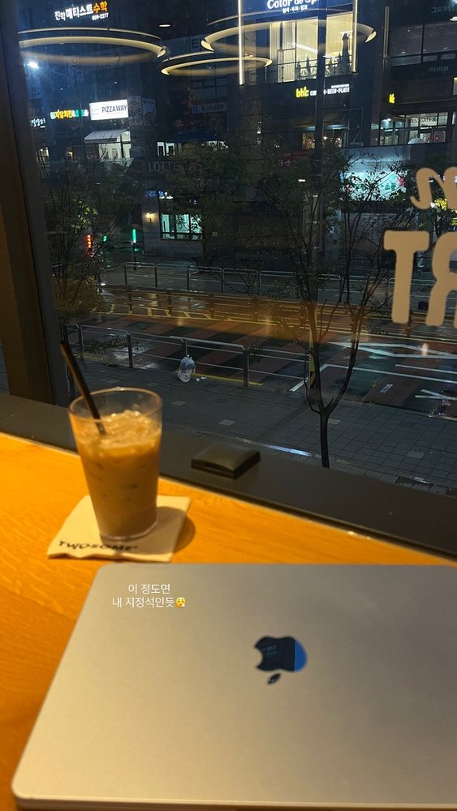

**집_금천구 4** (단서 13개 → 증거 23개)

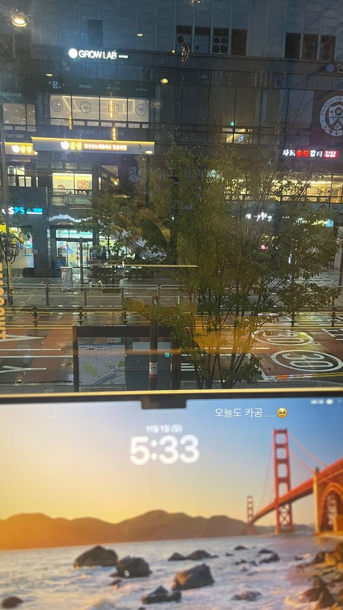

**집_금천구 5** (단서 10개 → 증거 25개)

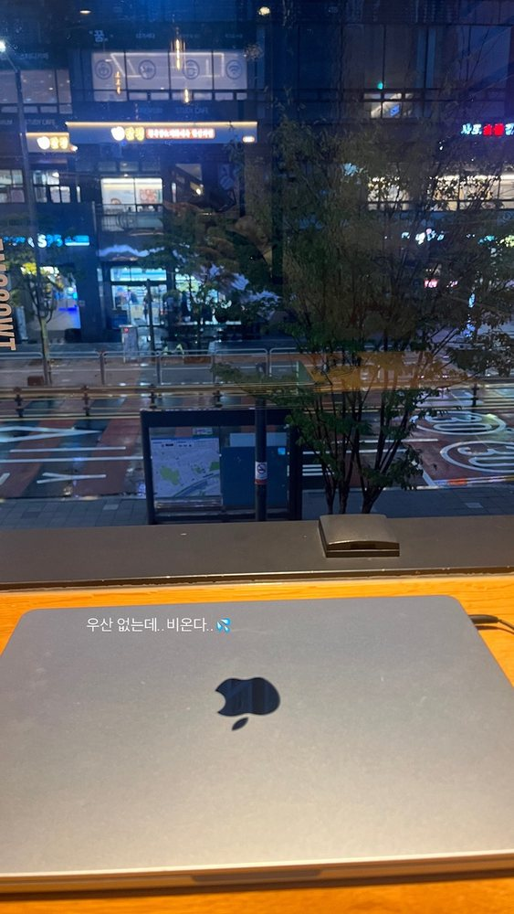

**집_금천구 7** (단서 11개 → 증거 22개)

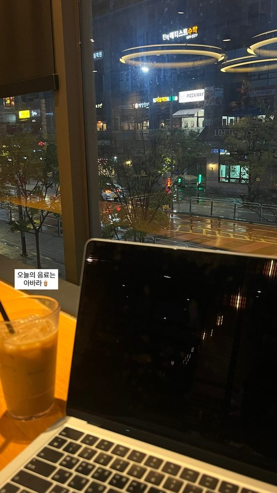

증거 94개 → 고유 단서 47개. 여러 사진에 걸쳐 묶인 단서 21개:

| 묶인 키 | 사진 | 각 사진에서 이 단서가 가리키는 것 | 표시 |
|---|---|---|---|
| `scene/language/hangul` | 1, 4, 5, 7 | **사진 1** `scene` (값 hangul): 단서 1 상점 간판이 모두 한글과 영어가 섞여 적혀 있습니다. 모델은 한국으로 판단했습니다. / 단서 4 왼쪽 위에 "진학 매티스트 수학"이라고 적힌 수학 학원 간판, 위층에 "Color de ..." 상점 간판, 오른쪽에 "PREMIUM" 간판이 있으며, 그 밖에 작은 초록색·노란색 한글 간판들이 더 있습니다. / 단서 14 한국어 자막 "이 정도면 내 지정석인듯"이 있으며, 모델은 촬영자가 이 카페를 자주 찾는다는 뜻으로 해석했습니다. 스토리 형식의 세로 화면입니다. **사진 4** `scene` (값 hangul): 단서 1 간판이 모두 한글과 영어가 섞여 적혀 있습니다. 모델은 한국으로 판단했습니다. **사진 5** `scene` (값 hangul): 단서 1 상점 간판과 자막에 한글(한국어)이 쓰여 있고 "STUDY CAFE" 같은 영어 단어도 일부 있습니다. 모델은 한국으로 판단했습니다. / 단서 2 비 이모지와 함께 "우산 없는데.. 비온다.."라고 적혀 있습니다. SNS 스토리 형식의 한국어 자막이며 장소 이름은 없습니다. / 단서 3 맞은편은 여러 업소가 입주한 상가 건물입니다. 2층 띠 부분에 "STUDY CAFE" 글자, 옆에 작은 글씨가 딸린 노란색 조명 한글 간판(명확히 읽히지 않음), 꼭대기 근처에 "꿈."처럼 보이는 작은 간판, 오른쪽 가장자리에 빨간 네온 한글 간판, 왼쪽 가장자리에 "… **사진 7** `scene` (값 hangul): 단서 1 모든 간판과 오버레이 자막이 한국어(한글)이고 일부 영어 브랜드명이 있습니다. 모델은 한국으로 판단했습니다. | 종류만 같음 |
| `scene/language/latin` | 1, 4, 5, 7 | **사진 1** `scene` (값 latin): 단서 1 상점 간판이 모두 한글과 영어가 섞여 적혀 있습니다. 모델은 한국으로 판단했습니다. / 단서 3 노란색 "bhc" 간판(한국 프라이드치킨 체인)과 그 옆에 붙은 "BEER PLATE" 형태의 간판이 있고, 왼쪽 건물에는 "PIZZAWAY" 간판이 있습니다. **사진 4** `scene` (값 latin): 단서 1 간판이 모두 한글과 영어가 섞여 적혀 있습니다. 모델은 한국으로 판단했습니다. **사진 5** `scene` (값 latin): 단서 1 상점 간판과 자막에 한글(한국어)이 쓰여 있고 "STUDY CAFE" 같은 영어 단어도 일부 있습니다. 모델은 한국으로 판단했습니다. / 단서 3 맞은편은 여러 업소가 입주한 상가 건물입니다. 2층 띠 부분에 "STUDY CAFE" 글자, 옆에 작은 글씨가 딸린 노란색 조명 한글 간판(명확히 읽히지 않음), 꼭대기 근처에 "꿈."처럼 보이는 작은 간판, 오른쪽 가장자리에 빨간 네온 한글 간판, 왼쪽 가장자리에 "… **사진 7** `scene` (값 latin): 단서 1 모든 간판과 오버레이 자막이 한국어(한글)이고 일부 영어 브랜드명이 있습니다. 모델은 한국으로 판단했습니다. | 종류만 같음 |
| `scene/layout` | 1, 4, 5, 7 | **사진 1** `scene`: 단서 2 컵받침에 "TWOSOME"이 인쇄되어 있습니다. 모델은 한국 커피 체인인 투썸플레이스(A Twosome Place)의 한 지점 안 창가 카운터석에서 찍은 사진이라고 판단했습니다. / 단서 12 대략 2층 높이에서 큰 창을 통해 내려다본 시점이며, 실내의 고리 모양 천장 조명이 유리에 비쳐 있습니다. **사진 4** `scene`: 단서 9 오버레이 문구 "오늘도 카공...."은 오늘도 카페에서 공부한다는 뜻입니다. 모델은 카페나 스터디카페 안에서 찍은 사진이라고 판단했습니다. / 단서 12 대략 2층 또는 3층에서 반사가 비치는 창을 통해 찍었으며, 상가 건물의 길 바로 건너편입니다. **사진 5** `scene`: 단서 10 2층쯤의 창가 카운터석에서 찍었으며, 모델은 카페일 가능성이 높다고 보았습니다. 유리 앞에 나무 카운터, 닫힌 짙은 파란색 Apple MacBook, 테이블 콘센트 덮개가 있습니다. **사진 7** `scene`: 단서 5 노란색 박스·지그재그 표시와 적갈색 포장이 있는 교차로이며, 모델은 어린이보호구역이나 보호구역과 일치한다고 보았습니다. 신호등은 빨간불과 초록불이 켜져 있고 도로는 다차로입니다. / 단서 9 후미등을 켠 흰색 세단이 도로 오른쪽으로 주행하고 있습니다(우측통행). / 단서 10 카페의 대략 2층 창가 카운터석이며, 고리 모양 천장 조명이 유리에 비쳐 있습니다. 나무 카운터 위에 아이스 커피 음료와 노트북이 있습니다. | 종류만 같음 |
| `text/PIZZAWAY` | 1, 7 | **사진 1** `shop_sign` (글자 "PIZZAWAY"): 단서 3 노란색 "bhc" 간판(한국 프라이드치킨 체인)과 그 옆에 붙은 "BEER PLATE" 형태의 간판이 있고, 왼쪽 건물에는 "PIZZAWAY" 간판이 있습니다. **사진 7** `shop_sign` (글자 "PIZZA WAY"): 단서 2 "...수학"으로 끝나고 전화번호가 적힌 수학 학원의 노란 네온 간판, "...학원"으로 끝나는 또 다른 간판, 흰색 조명 "PIZZA WAY" 간판, 프라이드치킨 프랜차이즈를 닮은 노란색·초록색 간판이 있으며, 위층에는 그 밖의 작은 상점 간판이 여럿 있습니다. | — |
| `text/PREMIUMSTUDYCAFE` | 1, 4, 5 | **사진 1** `shop_sign` (글자 "PREMIUM"): 단서 4 왼쪽 위에 "진학 매티스트 수학"이라고 적힌 수학 학원 간판, 위층에 "Color de ..." 상점 간판, 오른쪽에 "PREMIUM" 간판이 있으며, 그 밖에 작은 초록색·노란색 한글 간판들이 더 있습니다. **사진 4** `shop_sign` (글자 "STUDY CAFE"): 단서 2 위층에 "GROW LAB" 조명 간판, "STUDY CAFE" / "PREMIUM STUDY CAFE" 간판, 한글이 적힌 노란색 조명 상점 간판이 있고, 대략 "숯불갈비"로 읽히는 빨간 네온 식당 간판이 있습니다. **사진 4** `shop_sign` (글자 "PREMIUM STUDY CAFE"): 단서 2 위층에 "GROW LAB" 조명 간판, "STUDY CAFE" / "PREMIUM STUDY CAFE" 간판, 한글이 적힌 노란색 조명 상점 간판이 있고, 대략 "숯불갈비"로 읽히는 빨간 네온 식당 간판이 있습니다. **사진 5** `shop_sign` (글자 "STUDY CAFE"): 단서 1 상점 간판과 자막에 한글(한국어)이 쓰여 있고 "STUDY CAFE" 같은 영어 단어도 일부 있습니다. 모델은 한국으로 판단했습니다. / 단서 3 맞은편은 여러 업소가 입주한 상가 건물입니다. 2층 띠 부분에 "STUDY CAFE" 글자, 옆에 작은 글씨가 딸린 노란색 조명 한글 간판(명확히 읽히지 않음), 꼭대기 근처에 "꿈."처럼 보이는 작은 간판, 오른쪽 가장자리에 빨간 네온 한글 간판, 왼쪽 가장자리에 "… | 읽힌 형태가 다름 |
| `shop_sign/appearance` | 1, 4, 5, 7 | **사진 1** `shop_sign` (색 green+yellow): 단서 3 노란색 "bhc" 간판(한국 프라이드치킨 체인)과 그 옆에 붙은 "BEER PLATE" 형태의 간판이 있고, 왼쪽 건물에는 "PIZZAWAY" 간판이 있습니다. / 단서 4 왼쪽 위에 "진학 매티스트 수학"이라고 적힌 수학 학원 간판, 위층에 "Color de ..." 상점 간판, 오른쪽에 "PREMIUM" 간판이 있으며, 그 밖에 작은 초록색·노란색 한글 간판들이 더 있습니다. / 단서 13 창유리 오른쪽 가장자리에 크림색 큰 글자의 일부가 보이며("RT" 위에 필기체 장식이 있는 것으로 보임), 카페 창문 브랜딩의 일부입니다. **사진 4** `shop_sign` (색 red+yellow): 단서 2 위층에 "GROW LAB" 조명 간판, "STUDY CAFE" / "PREMIUM STUDY CAFE" 간판, 한글이 적힌 노란색 조명 상점 간판이 있고, 대략 "숯불갈비"로 읽히는 빨간 네온 식당 간판이 있습니다. **사진 5** `shop_sign` (색 red+yellow): 단서 3 맞은편은 여러 업소가 입주한 상가 건물입니다. 2층 띠 부분에 "STUDY CAFE" 글자, 옆에 작은 글씨가 딸린 노란색 조명 한글 간판(명확히 읽히지 않음), 꼭대기 근처에 "꿈."처럼 보이는 작은 간판, 오른쪽 가장자리에 빨간 네온 한글 간판, 왼쪽 가장자리에 "… / 단서 7 층마다 입주 업소 간판이 층층이 붙은 중층 유리 외벽 상가 건물들이며, 1층에는 밝게 불 켜진 점포들이 있습니다. 모델은 전형적인 한국 동네 상가 거리라고 판단했습니다. **사진 7** `shop_sign` (색 white+yellow): 단서 2 "...수학"으로 끝나고 전화번호가 적힌 수학 학원의 노란 네온 간판, "...학원"으로 끝나는 또 다른 간판, 흰색 조명 "PIZZA WAY" 간판, 프라이드치킨 프랜차이즈를 닮은 노란색·초록색 간판이 있으며, 위층에는 그 밖의 작은 상점 간판이 여럿 있습니다. | 종류만 같음 |
| `text/LOTTECAS` | 1, 7 | **사진 1** `building_sign` (글자 "LOTTE" (일부만 읽힘)): 단서 6 길 건너편 건물 외벽에 "LOTTE"로 시작하는 큰 글자가 있습니다. 모델은 롯데캐슬 상가동과 같은 롯데 브랜드 단지로 추정했습니다. **사진 7** `building_sign` (글자 "LOTTE CAS" (일부만 읽힘)): 단서 3 오른쪽 건물 외벽 글자가 "LOTTE CAS..."로 읽히는 것으로 보입니다(롯데캐슬일 가능성이 높음). 모델은 롯데캐슬 아파트 단지의 상가동이거나 단지에 인접한 건물로 추정했습니다. | 읽힌 형태가 다름 |
| `road/appearance` | 1, 4, 5, 7 | **사진 1** `road` (색 red+white): 단서 7 붉게 칠해진 노면 구간과 흰색 표시가 있는 다차로 도로이며, 모델은 한국의 어린이보호구역이나 보호구역에서 흔히 보이는 형태라고 판단했습니다. 노란색 연석선·가장자리선도 있습니다. / 단서 11 밤 시간대이며, 도로와 인도가 젖어 빛을 반사하고 있습니다. 모델은 최근에 비가 온 것으로 판단했습니다. **사진 4** `road` (색 red): 단서 5 붉게 칠해진 노면에 원 안에 든 큰 "30" 제한속도 표시가 있습니다. 모델은 한국의 어린이보호구역(스쿨존)이나 보행자우선도로의 전형적인 모습이라고 판단했습니다. / 단서 11 해 질 녘 또는 초저녁의 빛에 상점 불이 켜져 있고 거리가 젖어 빛을 반사하고 있습니다. 모델은 비가 온 뒤인 11월 1일 오후 5시 33분경과 일치한다고 보았습니다. **사진 5** `road` (색 red+white): 단서 4 붉은색 노면에 타원 안에 든 큰 흰색 "30" 제한속도 표시와 흰색 화살표, 차선이 있습니다. 모델은 어린이보호구역(스쿨존) 같은 한국의 시속 30km 구역의 전형적인 모습이라고 판단했습니다. / 단서 6 다차로 도시 도로이며, 건너편 연석을 따라 금속 보행자 방호울타리가 있고 차도에는 낮은 분리대가 있습니다. 가까운 쪽 인도는 블록 포장입니다. / 단서 9 밤 또는 늦은 저녁이며, 도로와 인도가 젖어 빛을 반사하고 있어 비가 온 것과 일치합니다. **사진 7** `road` (색 brown+yellow): 단서 5 노란색 박스·지그재그 표시와 적갈색 포장이 있는 교차로이며, 모델은 어린이보호구역이나 보호구역과 일치한다고 보았습니다. 신호등은 빨간불과 초록불이 켜져 있고 도로는 다차로입니다. / 단서 8 밤 또는 저녁이며 비가 오고 있습니다. 젖은 노면에 불빛이 반사되고 있습니다. | 종류만 같음 |
| `barrier/appearance` | 1, 4, 5, 7 | **사진 1** `barrier` (재질 metal): 단서 8 인도를 따라 금속 보행자 방호울타리가 있고 중앙분리대에는 울타리가 설치되어 있습니다. 인도는 회색 블록 포장이며, 연석 옆에 흰색 쓰레기봉투가 놓여 있습니다. **사진 4** `barrier` (재질 metal): 단서 6 노선도 패널과 금연 스티커가 붙은 버스 정류장 쉘터가 있고, 인도를 따라 금속 보행자 방호울타리가 있습니다. **사진 5** `barrier` (재질 metal): 단서 6 다차로 도시 도로이며, 건너편 연석을 따라 금속 보행자 방호울타리가 있고 차도에는 낮은 분리대가 있습니다. 가까운 쪽 인도는 블록 포장입니다. **사진 7** `barrier` (재질 metal): 단서 6 인도와 횡단보도를 따라 금속 보행자 방호울타리가 있고, 가로등과 벽돌 포장 인도가 있습니다. | 종류만 같음 |
| `pavement/appearance` | 1, 5, 7 | **사진 1** `pavement` (색 grey): 단서 8 인도를 따라 금속 보행자 방호울타리가 있고 중앙분리대에는 울타리가 설치되어 있습니다. 인도는 회색 블록 포장이며, 연석 옆에 흰색 쓰레기봉투가 놓여 있습니다. **사진 5** `pavement`: 단서 6 다차로 도시 도로이며, 건너편 연석을 따라 금속 보행자 방호울타리가 있고 차도에는 낮은 분리대가 있습니다. 가까운 쪽 인도는 블록 포장입니다. / 단서 9 밤 또는 늦은 저녁이며, 도로와 인도가 젖어 빛을 반사하고 있어 비가 온 것과 일치합니다. **사진 7** `pavement` (재질 brick): 단서 6 인도와 횡단보도를 따라 금속 보행자 방호울타리가 있고, 가로등과 벽돌 포장 인도가 있습니다. | 종류만 같음 |
| `building/appearance` | 1, 4, 5, 7 | **사진 1** `building` (재질 glass): 단서 9 층마다 간판이 층층이 붙은 다층 복합 상가 건물로, 유리 외벽과 밝게 불 켜진 위층 상점들이 보입니다. 모델은 아파트 단지 인근 한국 동네 상가 거리의 전형적인 모습이라고 판단했습니다. **사진 4** `building`: 단서 7 상점 간판이 층층이 붙고 외부 계단과 에어컨 실외기가 있는 다층 복합 상가 건물입니다. 모델은 한국의 주거 지역이나 신도시 지구 상가 블록의 전형적인 모습이라고 판단했습니다. **사진 5** `building` (재질 glass): 단서 3 맞은편은 여러 업소가 입주한 상가 건물입니다. 2층 띠 부분에 "STUDY CAFE" 글자, 옆에 작은 글씨가 딸린 노란색 조명 한글 간판(명확히 읽히지 않음), 꼭대기 근처에 "꿈."처럼 보이는 작은 간판, 오른쪽 가장자리에 빨간 네온 한글 간판, 왼쪽 가장자리에 "… / 단서 7 층마다 입주 업소 간판이 층층이 붙은 중층 유리 외벽 상가 건물들이며, 1층에는 밝게 불 켜진 점포들이 있습니다. 모델은 전형적인 한국 동네 상가 거리라고 판단했습니다. **사진 7** `building`: 단서 4 학원과 식당이 빽빽이 들어찬 어두운 다층 상가 건물이며, 모델은 한국 아파트·주거 지역 상가 블록의 전형적인 모습이라고 판단했습니다. 배경에는 중층·고층 건물들이 있습니다. | 종류만 같음 |
| `vegetation/appearance` | 1, 4, 5, 7 | **사진 1** `vegetation`: 단서 10 잎이 가늘고 듬성듬성한 어린 낙엽수 가로수가 있습니다. 모델은 늦가을로 추정했습니다. **사진 4** `vegetation` (색 green+yellow): 단서 8 초록빛과 노란빛 잎이 달린 어린 낙엽수 가로수가 있으며, 모델은 온대 기후의 가을과 일치한다고 보았습니다. **사진 5** `vegetation` (색 green): 단서 8 인도를 따라 잎이 무성한 초록색 낙엽수 가로수가 심어져 있고, 한 그루는 창문 바로 앞에 있습니다. 모델은 따뜻한 계절로 추정했습니다. **사진 7** `vegetation` (색 green+yellow): 단서 7 연두색 잎이 달린 어린 낙엽수 가로수가 있습니다. 모델은 가을로 추정했습니다. | 종류만 같음 |
| `scene/season` | 1, 4, 5, 7 | **사진 1** `scene` (값 autumn): 단서 10 잎이 가늘고 듬성듬성한 어린 낙엽수 가로수가 있습니다. 모델은 늦가을로 추정했습니다. **사진 4** `scene` (값 autumn): 단서 8 초록빛과 노란빛 잎이 달린 어린 낙엽수 가로수가 있으며, 모델은 온대 기후의 가을과 일치한다고 보았습니다. / 단서 10 잠금 화면에 날짜 "11월 1일"과 시각 5:33이 한국식 형식으로 표시되어 있습니다. 배경화면은 금문교 스톡 이미지이며 실제 위치의 단서는 아닙니다. / 단서 11 해 질 녘 또는 초저녁의 빛에 상점 불이 켜져 있고 거리가 젖어 빛을 반사하고 있습니다. 모델은 비가 온 뒤인 11월 1일 오후 5시 33분경과 일치한다고 보았습니다. **사진 5** `scene` (값 summer): 단서 8 인도를 따라 잎이 무성한 초록색 낙엽수 가로수가 심어져 있고, 한 그루는 창문 바로 앞에 있습니다. 모델은 따뜻한 계절로 추정했습니다. **사진 7** `scene` (값 autumn): 단서 7 연두색 잎이 달린 어린 낙엽수 가로수가 있습니다. 모델은 가을로 추정했습니다. | 종류만 같음 |
| `scene/time` | 1, 4, 5, 7 | **사진 1** `scene` (값 night): 단서 11 밤 시간대이며, 도로와 인도가 젖어 빛을 반사하고 있습니다. 모델은 최근에 비가 온 것으로 판단했습니다. **사진 4** `scene` (값 dusk): 단서 11 해 질 녘 또는 초저녁의 빛에 상점 불이 켜져 있고 거리가 젖어 빛을 반사하고 있습니다. 모델은 비가 온 뒤인 11월 1일 오후 5시 33분경과 일치한다고 보았습니다. **사진 5** `scene` (값 night): 단서 9 밤 또는 늦은 저녁이며, 도로와 인도가 젖어 빛을 반사하고 있어 비가 온 것과 일치합니다. **사진 7** `scene` (값 night): 단서 8 밤 또는 저녁이며 비가 오고 있습니다. 젖은 노면에 불빛이 반사되고 있습니다. | 종류만 같음 |
| `scene/weather` | 1, 4, 5, 7 | **사진 1** `scene` (값 rain): 단서 11 밤 시간대이며, 도로와 인도가 젖어 빛을 반사하고 있습니다. 모델은 최근에 비가 온 것으로 판단했습니다. **사진 4** `scene` (값 rain): 단서 11 해 질 녘 또는 초저녁의 빛에 상점 불이 켜져 있고 거리가 젖어 빛을 반사하고 있습니다. 모델은 비가 온 뒤인 11월 1일 오후 5시 33분경과 일치한다고 보았습니다. **사진 5** `scene` (값 rain): 단서 2 비 이모지와 함께 "우산 없는데.. 비온다.."라고 적혀 있습니다. SNS 스토리 형식의 한국어 자막이며 장소 이름은 없습니다. / 단서 9 밤 또는 늦은 저녁이며, 도로와 인도가 젖어 빛을 반사하고 있어 비가 온 것과 일치합니다. **사진 7** `scene` (값 rain): 단서 8 밤 또는 저녁이며 비가 오고 있습니다. 젖은 노면에 불빛이 반사되고 있습니다. | 종류만 같음 |
| `lighting/appearance` | 1, 5, 7 | **사진 1** `lighting`: 단서 12 대략 2층 높이에서 큰 창을 통해 내려다본 시점이며, 실내의 고리 모양 천장 조명이 유리에 비쳐 있습니다. **사진 5** `lighting`: 단서 5 가까운 쪽 인도에 버스 정류장 쉘터가 있으며, 녹지와 곡선이 그려진 지도·노선 안내 패널이 있고 기둥에는 금연 스티커가 붙어 있습니다. 왼쪽 위에는 가로등이 있습니다. **사진 7** `lighting`: 단서 6 인도와 횡단보도를 따라 금속 보행자 방호울타리가 있고, 가로등과 벽돌 포장 인도가 있습니다. | 속성 없음, 종류만 같음 |
| `text/30` | 4, 5 | **사진 4** `road` (글자 "30"): 단서 5 붉게 칠해진 노면에 원 안에 든 큰 "30" 제한속도 표시가 있습니다. 모델은 한국의 어린이보호구역(스쿨존)이나 보행자우선도로의 전형적인 모습이라고 판단했습니다. **사진 5** `road` (글자 "30"): 단서 4 붉은색 노면에 타원 안에 든 큰 흰색 "30" 제한속도 표시와 흰색 화살표, 차선이 있습니다. 모델은 어린이보호구역(스쿨존) 같은 한국의 시속 30km 구역의 전형적인 모습이라고 판단했습니다. | — |
| `street_furniture/appearance` | 4, 5 | **사진 4** `street_furniture`: 단서 6 노선도 패널과 금연 스티커가 붙은 버스 정류장 쉘터가 있고, 인도를 따라 금속 보행자 방호울타리가 있습니다. **사진 5** `street_furniture`: 단서 5 가까운 쪽 인도에 버스 정류장 쉘터가 있으며, 녹지와 곡선이 그려진 지도·노선 안내 패널이 있고 기둥에는 금연 스티커가 붙어 있습니다. 왼쪽 위에는 가로등이 있습니다. | 속성 없음, 종류만 같음 |
| `transit_sign/appearance` | 4, 5 | **사진 4** `transit_sign`: 단서 6 노선도 패널과 금연 스티커가 붙은 버스 정류장 쉘터가 있고, 인도를 따라 금속 보행자 방호울타리가 있습니다. **사진 5** `transit_sign` (색 green): 단서 5 가까운 쪽 인도에 버스 정류장 쉘터가 있으며, 녹지와 곡선이 그려진 지도·노선 안내 패널이 있고 기둥에는 금연 스티커가 붙어 있습니다. 왼쪽 위에는 가로등이 있습니다. | 종류만 같음 |
| `interior/appearance` | 5, 7 | **사진 5** `interior` (재질 wood): 단서 10 2층쯤의 창가 카운터석에서 찍었으며, 모델은 카페일 가능성이 높다고 보았습니다. 유리 앞에 나무 카운터, 닫힌 짙은 파란색 Apple MacBook, 테이블 콘센트 덮개가 있습니다. **사진 7** `interior` (재질 glass+wood): 단서 10 카페의 대략 2층 창가 카운터석이며, 고리 모양 천장 조명이 유리에 비쳐 있습니다. 나무 카운터 위에 아이스 커피 음료와 노트북이 있습니다. | 종류만 같음 |
| `product/appearance` | 5, 7 | **사진 5** `product` (색 blue): 단서 10 2층쯤의 창가 카운터석에서 찍었으며, 모델은 카페일 가능성이 높다고 보았습니다. 유리 앞에 나무 카운터, 닫힌 짙은 파란색 Apple MacBook, 테이블 콘센트 덮개가 있습니다. **사진 7** `product`: 단서 10 카페의 대략 2층 창가 카운터석이며, 고리 모양 천장 조명이 유리에 비쳐 있습니다. 나무 카운터 위에 아이스 커피 음료와 노트북이 있습니다. | 종류만 같음 |

한 사진에만 있는 단서:

- 사진 1: `text|TWOSOME`, `text|BHC`, `text|BEERPLATE`, `text|진학매티스트수학`, `text|COLORDE`, `text|2277`, `text|RT`, `text|이정도면내지정석인듯`
- 사진 4: `text|GROWLAB`, `text|숯불갈비`, `text|GS25`, `text|YONSEIU`, `text|오늘도카공`, `text|11월1일`, `text|533`
- 사진 5: `text|우산없는데비온다`, `text|꿈`, `text|COUNT`, `text|WIFI`, `notice|appearance`, `text|APPLE`
- 사진 7: `text|수학`, `text|학원`, `utility|appearance`, `vehicle|appearance`, `text|오늘의음료는아바라`

#### C1 · 집_합정 1·5·9·14

**집_합정 1** (단서 11개 → 증거 12개)

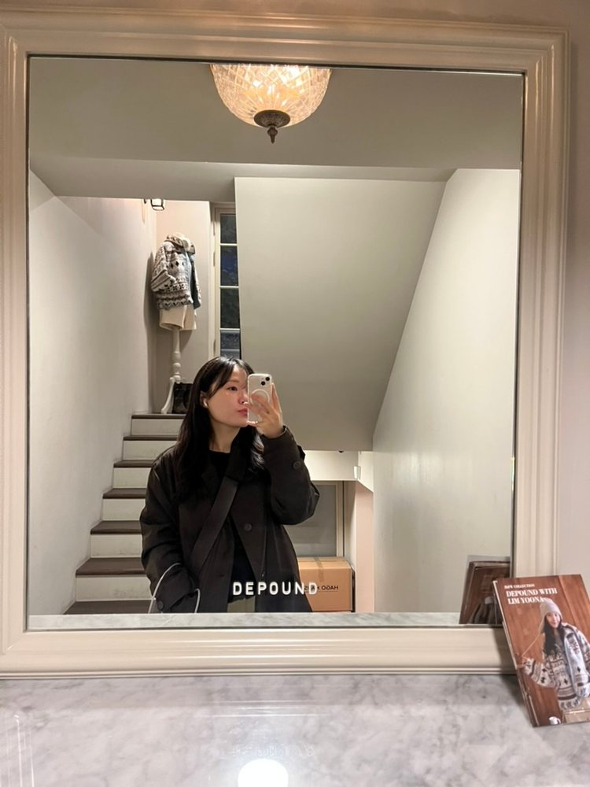

**집_합정 5** (단서 10개 → 증거 10개)

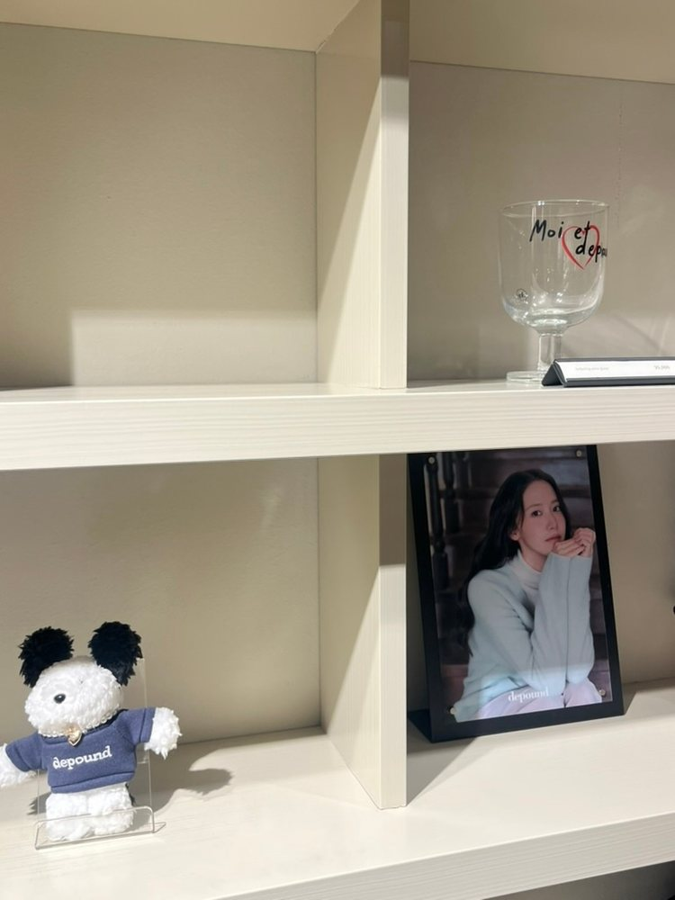

**집_합정 9** (단서 7개 → 증거 6개)

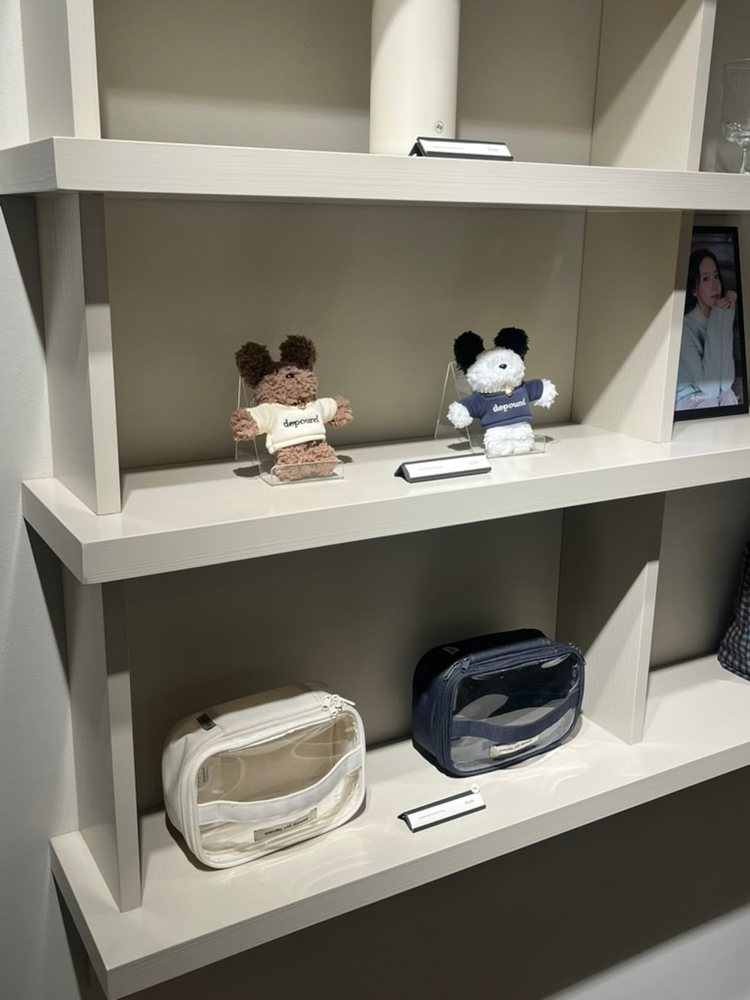

**집_합정 14** (단서 10개 → 증거 12개)

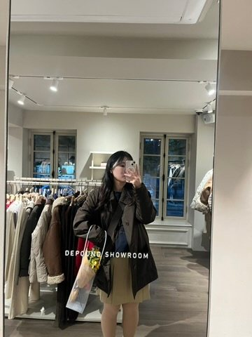

증거 40개 → 고유 단서 19개. 여러 사진에 걸쳐 묶인 단서 11개:

| 묶인 키 | 사진 | 각 사진에서 이 단서가 가리키는 것 | 표시 |
|---|---|---|---|
| `text/DEPOUNDSHOWROOM` | 1, 5, 9, 14 | **사진 1** `shop_sign` (글자 "DEPOUND"): 단서 1 거울 유리에 흰색 글자로 "DEPOUND"가 붙어 있습니다. 모델은 DEPOUND가 한국의 패션·라이프스타일 브랜드이므로 그 쇼룸 또는 매장 중 한 곳으로 판단했습니다. **사진 5** `product` (글자 "depound"): 단서 1 곰 인형의 네이비 스웨터와 유리잔, 액자에 든 캠페인 사진에 "depound"라는 단어가 보입니다. 모델은 depound 브랜드 매장 또는 쇼룸으로 판단했으며, depound는 서울에 본사를 둔 한국의 라이프스타일·패션 브랜드라고 설명했습니다. / 단서 2 고블릿 잔에는 "Moi et depound"와 빨간 하트가 인쇄되어 있고, 곰 인형의 스웨터에는 "depound"라고 적혀 있습니다. 액자 사진 하단에도 "depound" 워드마크가 들어가 있습니다. **사진 5** `product` (글자 "Moi et depound"): 단서 2 고블릿 잔에는 "Moi et depound"와 빨간 하트가 인쇄되어 있고, 곰 인형의 스웨터에는 "depound"라고 적혀 있습니다. 액자 사진 하단에도 "depound" 워드마크가 들어가 있습니다. / 단서 3 라틴 문자로 된 브랜드 문구와 장식용 프랑스어 구절("Moi et")이 보입니다. 화면에서 읽을 수 있는 한글은 없어, 모델은 언어만으로는 국가를 특정할 수 없다고 판단했습니다. **사진 9** `product` (글자 "depound"): 단서 1 곰 인형 두 개의 크림색·네이비색 스웨터에 "depound"라는 단어가 자수로 새겨져 있고, 파우치 라벨에도 보입니다. 모델은 depound가 한국의 라이프스타일·액세서리 브랜드라는 점에서 한국, 그중 서울일 가능성이 가장 높다고 판단했습니다. / 단서 6 라틴 문자로 된 브랜드 글자("depound")만 읽을 수 있습니다. 화면에는 읽을 수 있는 한글이나 다른 문자가 보이지 않습니다. **사진 14** `overlay` (글자 "DEPOUND SHOWROOM"): 단서 1 이미지 가운데를 가로질러 "DEPOUND SHOWROOM"이라는 문구가 덧입혀져 있습니다. 그 외에 읽을 수 있는 간판, 주소, 도로명은 없습니다. / 단서 9 이 문구는 소셜 미디어 스토리에서 흔히 쓰이는 추가 캡션 또는 위치 스티커 형태로 보입니다. 모델은 사진이 장소 이름과 함께 공유되었음을 시사한다고 판단했습니다. | 읽힌 형태가 다름 |
| `product/appearance` | 1, 5, 9, 14 | **사진 1** `product` (색 beige+brown, 재질 fabric): 단서 2 거울에 기대어 놓인 책자에 "DEPOUND WITH LIM YOONA"라고 적혀 있고, 그 아래 작은 글씨는 "... COLLECTION"으로 읽히는 것으로 보입니다. 표지에는 무늬 니트 카디건과 비니를 착용한 모델이 실려 있으며, 시즌 캠페인 룩북입니다. / 단서 4 계단 위쪽의 흰색 마네킹 스탠드에 노르딕풍 무늬 니트 카디건과 크림색 하의가 걸려 있으며, 책자 표지의 니트웨어와 일치합니다. / 단서 8 카운터 뒤에 갈색 골판지 배송 상자가 있고, 일부만 보이는 인쇄 라벨은 "ODAH"로 끝납니다. **사진 5** `product` (색 blue+white, 재질 fabric+glass): 단서 1 곰 인형의 네이비 스웨터와 유리잔, 액자에 든 캠페인 사진에 "depound"라는 단어가 보입니다. 모델은 depound 브랜드 매장 또는 쇼룸으로 판단했으며, depound는 서울에 본사를 둔 한국의 라이프스타일·패션 브랜드라고 설명했습니다. / 단서 2 고블릿 잔에는 "Moi et depound"와 빨간 하트가 인쇄되어 있고, 곰 인형의 스웨터에는 "depound"라고 적혀 있습니다. 액자 사진 하단에도 "depound" 워드마크가 들어가 있습니다. / 단서 6 라이프스타일 상품으로, 아크릴 받침대 위에 놓인 검은 귀의 흰색 곰 인형(네이비 브랜드 스웨터 착용)과 투명한 스템 고블릿 유리잔입니다. **사진 9** `product` (색 beige+blue, 재질 fabric+plastic): 단서 1 곰 인형 두 개의 크림색·네이비색 스웨터에 "depound"라는 단어가 자수로 새겨져 있고, 파우치 라벨에도 보입니다. 모델은 depound가 한국의 라이프스타일·액세서리 브랜드라는 점에서 한국, 그중 서울일 가능성이 가장 높다고 판단했습니다. / 단서 2 브랜드 스웨터를 입은 곰 인형 키링과 아이보리색·네이비색의 투명 PVC 파우치입니다. 모델은 이 브랜드가 자체 쇼룸과 팝업에서 판매하는 대표 상품과 일치한다고 보았습니다. **사진 14** `product` (색 beige+brown): 단서 6 옷걸이 행거에 패딩 재킷, 플리스·시어링 재킷, 크림·베이지·브라운·블랙 톤의 코트 등 겨울 상품이 걸려 있고, 오른쪽에도 옷이 더 걸려 있습니다. | 종류만 같음 |
| `scene/language/latin` | 1, 5, 9, 14 | **사진 1** `scene` (값 latin): 단서 3 보이는 글자는 모두 라틴 문자(영어)이며, 책자에 적힌 이름은 로마자로 표기한 한국 이름입니다. 모델은 한국을 가리키는 단서로 보았습니다. **사진 5** `scene` (값 latin): 단서 3 라틴 문자로 된 브랜드 문구와 장식용 프랑스어 구절("Moi et")이 보입니다. 화면에서 읽을 수 있는 한글은 없어, 모델은 언어만으로는 국가를 특정할 수 없다고 판단했습니다. **사진 9** `scene` (값 latin): 단서 6 라틴 문자로 된 브랜드 글자("depound")만 읽을 수 있습니다. 화면에는 읽을 수 있는 한글이나 다른 문자가 보이지 않습니다. **사진 14** `scene` (값 latin): 단서 1 이미지 가운데를 가로질러 "DEPOUND SHOWROOM"이라는 문구가 덧입혀져 있습니다. 그 외에 읽을 수 있는 간판, 주소, 도로명은 없습니다. | 종류만 같음 |
| `interior/appearance` | 1, 5, 9, 14 | **사진 1** `interior` (색 brown+white, 재질 stone+wood): 단서 5 짙은 색 목재 디딤판과 흰색 챌판으로 된 좁은 계단, 위층 계단 아래의 경사진 흰색 천장, 흰색 회벽이 있습니다. 모델은 다층 주택을 개조한 구조로 보았습니다. / 단서 6 황동 꼭지 장식이 달린 컷글라스 돔형 천장등, 폭이 넓은 크림색 몰딩 거울 프레임, 회색 결이 있는 흰색 대리석 카운터, 작은 벽등이 있으며, 빈티지 유럽풍 부티크 장식입니다. / 단서 10 계단참에 세로로 길고 좁은 여러 칸짜리 창이 있으며, 밖은 어두워 식별할 수 있는 외부 특징이 없습니다. **사진 5** `interior` (색 beige+white, 재질 wood): 단서 8 크림·아이보리색으로 칠한 목재 칸막이 선반에 베이지색 뒷판이 달려 있습니다. 모델은 한국 라이프스타일 브랜드 쇼룸에서 흔한 미니멀하고 부드러운 톤의 스타일링이라고 보았습니다. **사진 9** `interior` (색 beige, 재질 plastic+wood): 단서 3 칸막이가 엇갈리게 배치된 크림·아이보리색 나뭇결 선반과 중성적인 베이지색 벽으로 이루어진 미니멀한 공간입니다. 모델은 한국 라이프스타일 브랜드 쇼룸이나 백화점 팝업에서 흔한 모습이라고 보았습니다. / 단서 4 인형용 투명 아크릴 받침대와, 비스듬한 홀더에 꽂힌 작은 흑백 가격 카드가 있습니다. 글자가 너무 작아 읽을 수 없어 통화(원화일 가능성이 높음)는 확인할 수 없습니다. / 단서 7 부드럽고 따뜻한 실내 인공조명이며 창문이나 바깥 풍경이 없어 거리나 동네에 관한 단서는 없습니다. 구체적인 지점은 판단할 수 없으며, 모델의 최선의 추정은 대한민국 서울의 depound 쇼룸 또는 팝업입니다. **사진 14** `interior` (색 white, 재질 wood): 단서 3 소규모 부티크 의류 쇼룸 또는 소매점이며, 큰 전신 거울을 통해 촬영되었습니다. / 단서 4 흰 벽과 천장, 노출된 천장 보 라인, 나무 판자 바닥, 벽걸이 선반이 보입니다. 모델은 서울에서 쇼룸으로 흔히 쓰이는 개조된 주택이나 저층 빌라와 비슷한 구조라고 보았습니다. / 단서 5 흰색 프레임의 여러 칸으로 나뉜 여닫이창이 있고, 바깥은 어두우며 맞은편에 불 켜진 방들이 보입니다. 모델은 밀집한 도심 주택가의 저녁 시간, 저층 건물의 위층 또는 1층으로 추정했습니다. | 종류만 같음 |
| `lighting/appearance` | 1, 5, 14 | **사진 1** `lighting` (색 gold, 재질 glass+metal): 단서 6 황동 꼭지 장식이 달린 컷글라스 돔형 천장등, 폭이 넓은 크림색 몰딩 거울 프레임, 회색 결이 있는 흰색 대리석 카운터, 작은 벽등이 있으며, 빈티지 유럽풍 부티크 장식입니다. **사진 5** `lighting`: 단서 9 따뜻한 인공 스폿 조명이 부드러운 그림자를 드리우고 있습니다. 창문이나 바깥 풍경이 보이지 않아 외부 단서는 없습니다. **사진 14** `lighting`: 단서 8 천장 트랙 스포트라이트, 오른쪽 위 벽에 설치된 보안 카메라, 따뜻한 실내 조명이 보입니다. | 종류만 같음 |
| `people/appearance` | 1, 14 | **사진 1** `people`: 단서 9 인물이 두꺼운 어두운 색 재킷을 입고 있고 겨울 니트웨어가 진열되어 있습니다. 모델은 가을 또는 겨울로 추정했습니다. **사진 14** `people` (색 beige): 단서 7 인물은 겹쳐 입은 상의 위에 어두운 오버사이즈 재킷을 걸치고 짧은 베이지색 스커트를 입고 있습니다. 모델은 겨울 상품과 함께 볼 때 늦가을 또는 겨울로 추정했습니다. | 종류만 같음 |
| `scene/season` | 1, 14 | **사진 1** `scene` (값 winter): 단서 9 인물이 두꺼운 어두운 색 재킷을 입고 있고 겨울 니트웨어가 진열되어 있습니다. 모델은 가을 또는 겨울로 추정했습니다. **사진 14** `scene` (값 winter): 단서 6 옷걸이 행거에 패딩 재킷, 플리스·시어링 재킷, 크림·베이지·브라운·블랙 톤의 코트 등 겨울 상품이 걸려 있고, 오른쪽에도 옷이 더 걸려 있습니다. / 단서 7 인물은 겹쳐 입은 상의 위에 어두운 오버사이즈 재킷을 걸치고 짧은 베이지색 스커트를 입고 있습니다. 모델은 겨울 상품과 함께 볼 때 늦가을 또는 겨울로 추정했습니다. | 종류만 같음 |
| `scene/time` | 1, 14 | **사진 1** `scene` (값 night): 단서 10 계단참에 세로로 길고 좁은 여러 칸짜리 창이 있으며, 밖은 어두워 식별할 수 있는 외부 특징이 없습니다. / 단서 11 저녁 또는 밤이며, 실내 인공 조명만 켜져 있습니다. **사진 14** `scene` (값 night): 단서 5 흰색 프레임의 여러 칸으로 나뉜 여닫이창이 있고, 바깥은 어두우며 맞은편에 불 켜진 방들이 보입니다. 모델은 밀집한 도심 주택가의 저녁 시간, 저층 건물의 위층 또는 1층으로 추정했습니다. | 종류만 같음 |
| `notice/appearance` | 5, 9 | **사진 5** `notice` (색 black): 단서 4 유리잔 옆의 작은 검은색 삼각형 가격표에 상품명과 소수점 없는 "35,000" 안팎의 가격이 적힌 것으로 보입니다. 모델은 한국 원화 표기와 일치한다고 판단했습니다. **사진 9** `notice` (색 black+white): 단서 4 인형용 투명 아크릴 받침대와, 비스듬한 홀더에 꽂힌 작은 흑백 가격 카드가 있습니다. 글자가 너무 작아 읽을 수 없어 통화(원화일 가능성이 높음)는 확인할 수 없습니다. | 종류만 같음 |
| `scene/activity` | 5, 14 | **사진 5** `scene`: 단서 5 상품을 여유 있게 선별해 진열한 실내 브랜드 쇼룸, 플래그십 스토어 또는 팝업 진열 공간입니다. **사진 14** `scene`: 단서 3 소규모 부티크 의류 쇼룸 또는 소매점이며, 큰 전신 거울을 통해 촬영되었습니다. / 단서 10 노란색과 빨간색 꽃이 든 포장된 꽃다발을 담은 투명 비닐봉지와, 거울 셀카를 찍기 위해 들어 올린 스마트폰이 보입니다. | 종류만 같음 |
| `banner/appearance` | 5, 9 | **사진 5** `banner` (색 black+blue): 단서 7 검은 액자에 든 캠페인 사진으로, 긴 검은 머리의 여성이 연한 파란색 니트 스웨터를 입고 있으며 매장 내 브랜드 광고로 쓰였습니다. 직접적인 지리 정보는 주지 않습니다. **사진 9** `banner`: 단서 5 선반 오른쪽에 밝은색 니트 상의를 입은 모델의 캠페인 사진 액자가 세워져 있습니다. 모델은 여러 브랜드를 파는 리셀러가 아니라 공식 브랜드 매장 또는 브랜드 팝업이라고 판단했습니다. | 종류만 같음 |

한 사진에만 있는 단서:

- 사진 1: `shop_sign|appearance`, `text|DEPOUNDWITHLIMYOONA`, `text|COLLECTION`, `text|ODAH`
- 사진 5: `text|35000`
- 사진 14: `scene|layout`, `utility|appearance`, `other|appearance`

#### C2 · 집_합정 3·4·17·18

**집_합정 3** (단서 8개 → 증거 7개)

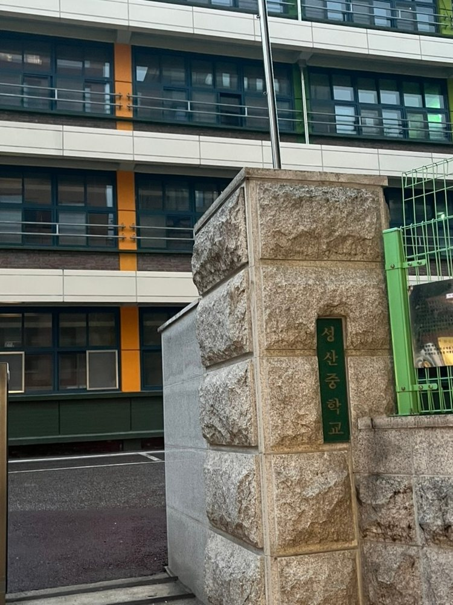

**집_합정 4** (단서 9개 → 증거 12개)

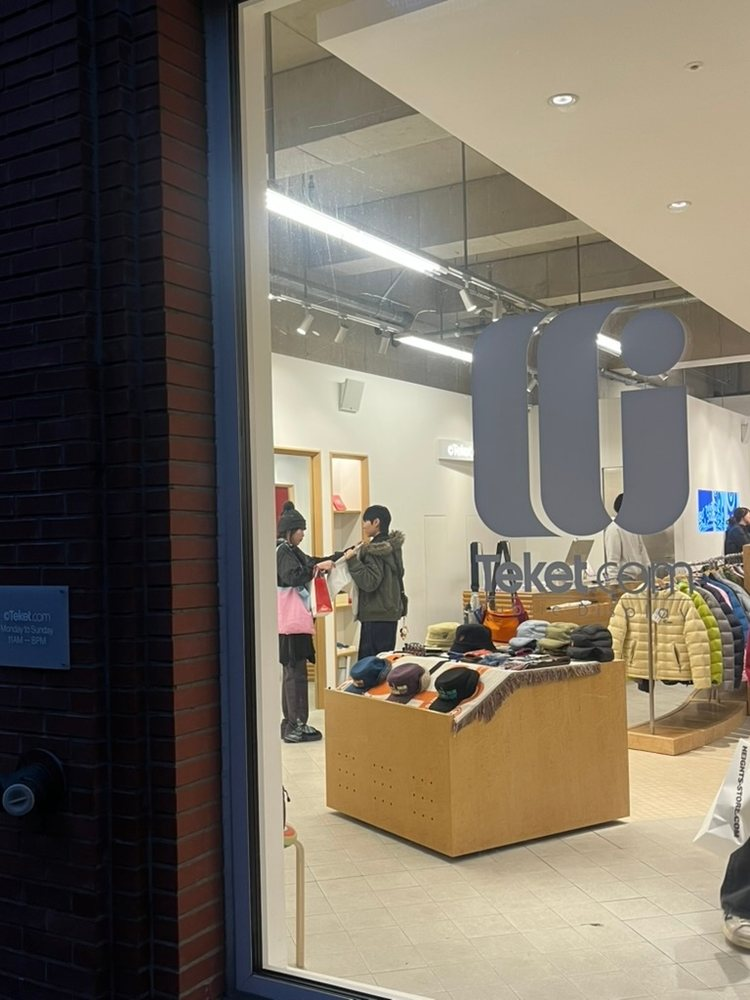

**집_합정 17** (단서 12개 → 증거 14개)

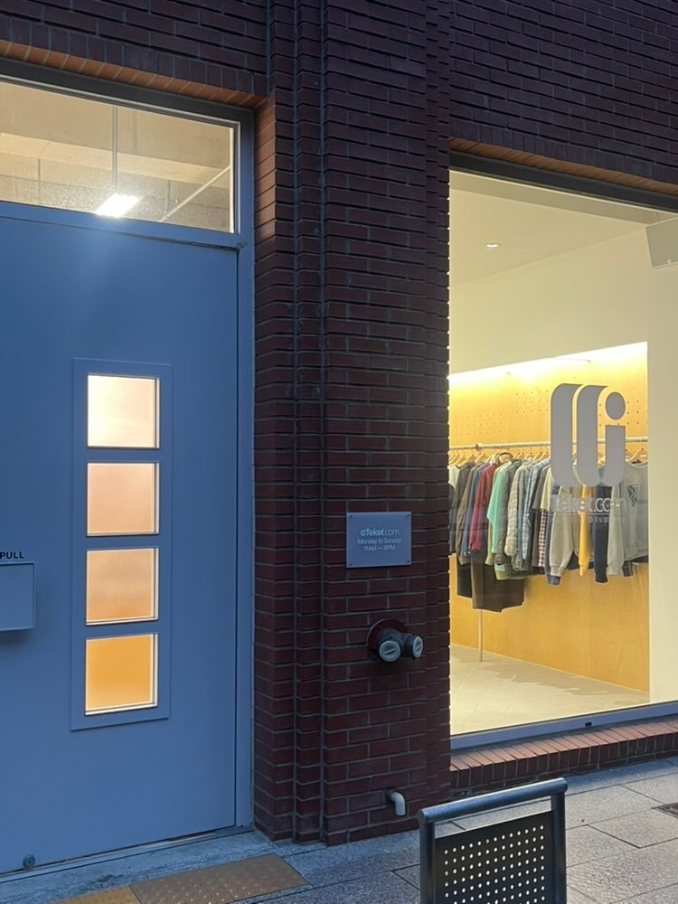

**집_합정 18** (단서 10개 → 증거 17개)

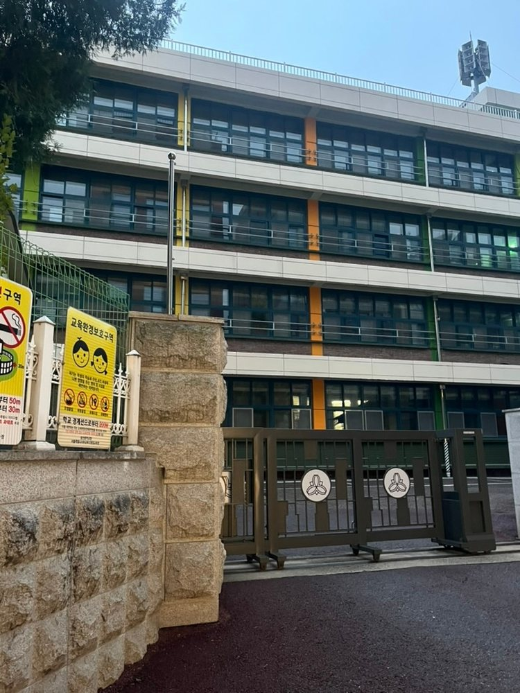

증거 50개 → 고유 단서 32개. 여러 사진에 걸쳐 묶인 단서 15개:

| 묶인 키 | 사진 | 각 사진에서 이 단서가 가리키는 것 | 표시 |
|---|---|---|---|
| `scene/language/hangul` | 3, 18 | **사진 3** `scene` (값 hangul): 단서 1 교문 기둥의 초록색 세로 명판에 "성산중학교"(Seongsan Middle School)라고 적혀 있습니다. / 단서 2 한글이 세로로 쓰여 있어 모델은 한국으로 판단했습니다. **사진 18** `scene` (값 hangul): 단서 1 모든 표지판이 한글로 되어 있어, 모델은 한국으로 판단했습니다. / 단서 2 노란색 표지판에 "교육환경보호구역"이라고 적혀 있고, 만화풍 어린이 두 명과 금지 아이콘, "학교 경계로부터 200M"라는 문구가 있습니다. 두 번째 표지판에는 금연 픽토그램과 "...구역", "50m"가 있으며, 발행 기관을 적은 작은 글씨는 읽을 수 없습니다. | 종류만 같음 |
| `building/appearance` | 3, 4, 17, 18 | **사진 3** `building` (색 beige+brown, 재질 brick): 단서 4 길게 이어진 수평 띠창과 짙은 청록색 창틀, 층마다 외부 안전 난간을 갖춘 여러 층짜리 한국 학교 건물입니다. / 단서 7 크림색 패널 외장에 주황색과 초록색 세로 포인트 줄무늬, 갈색 벽돌 구간이 있습니다. 모델은 개보수한 한국 학교 외벽에서 전형적인 모습이라고 보았습니다. **사진 4** `building` (색 red, 재질 brick+metal): 단서 5 짙은 붉은색 벽돌 벽에 어두운 금속 프레임의 진열창이 있습니다. 모델은 서울 성수동의 개조된 벽돌 건물에서 흔히 볼 수 있는 모습이라고 보았습니다. **사진 17** `building` (색 brown+red, 재질 brick+glass): 단서 5 길고 얇은 벽돌로 된 짙은 적갈색 외벽에, 개구부 위로 세워쌓기 띠가 둘러져 있습니다. 프레임 없는 큰 진열 유리창이 있는 현대식 저층 상업용 건물로, 모델은 서울과 도쿄의 리노베이션된 부티크 거리에서 흔한 양식이라고 보았습니다. **사진 18** `building` (색 beige+green, 재질 brick): 단서 3 정문에서 바라본 4~5층 규모의 공립학교 건물(초등학교 또는 중학교)입니다. / 단서 4 짙은 녹색 프레임의 긴 수평 띠창, 크림색 수평 패널, 벽돌 채움벽, 주황·노랑·초록의 수직 포인트 띠가 있습니다. 모델은 리모델링된 한국 공립학교의 전형이라고 보았습니다. | 종류만 같음 |
| `gate/appearance` | 3, 17, 18 | **사진 3** `gate` (재질 stone): 단서 5 거칠게 다듬은 화강석 블록 교문 기둥에 매끈한 화강석 덮개돌이 얹혀 있고, 같은 석재의 경계 담장이 이어집니다. **사진 17** `gate` (색 blue+grey, 재질 glass+metal): 단서 6 회청색 철문에 반투명 유리창 네 장이 세로로 쌓여 있고 위에는 고창이 있으며, 영어로 된 작은 "PULL" 라벨이 붙어 있습니다. **사진 18** `gate` (색 brown+white, 재질 metal+stone): 단서 5 갈색 접이식(자바라형) 금속 미닫이 교문에 세 갈래 잎 또는 꽃 모양의 학교 문장이 그려진 둥근 흰색 엠블럼 두 개가 붙어 있습니다. / 단서 6 거칠게 다듬은 화강암 블록 담장과 교문 기둥, 끝이 뾰족한 흰색 장식 금속 울타리, 그 뒤의 녹색 철망 울타리가 보입니다. | 종류만 같음 |
| `barrier/appearance` | 3, 18 | **사진 3** `barrier` (색 green, 재질 metal+stone): 단서 5 거칠게 다듬은 화강석 블록 교문 기둥에 매끈한 화강석 덮개돌이 얹혀 있고, 같은 석재의 경계 담장이 이어집니다. / 단서 6 초록색 강철 기둥이 달린 밝은 초록색 용접 철망 울타리로, 한국 학교 부지 주변에서 흔한 형태입니다. **사진 18** `barrier` (색 green+white, 재질 metal+stone): 단서 6 거칠게 다듬은 화강암 블록 담장과 교문 기둥, 끝이 뾰족한 흰색 장식 금속 울타리, 그 뒤의 녹색 철망 울타리가 보입니다. | 종류만 같음 |
| `road/appearance` | 3, 18 | **사진 3** `road` (재질 asphalt): 단서 8 교문 바로 안쪽에 흰색 선이 칠해진 짙은 아스팔트 마당 또는 진입로가 있습니다. **사진 18** `road` (재질 asphalt): 단서 9 어두운 아스팔트 진입로가 교문을 향해 오르막으로 이어집니다. 모델은 언덕이 많은 도심 주택가로 추정했습니다. | 종류만 같음 |
| `text/ETEKETCOM` | 4, 17 | **사진 4** `shop_sign` (글자 "eTeket.com" (일부만 읽힘)): 단서 1 창에 큰 회색 추상 로고가 있고 대략 "eTeket.com"으로 읽히는 워드마크(일부 가려짐)가 있습니다. 모델은 특정 매장을 식별해 주는 단서이자 가장 좋은 검색어라고 평가했습니다. / 단서 2 벽돌 벽의 작은 명판에 같은 매장 이름과 "Monday to Sunday 11AM - 8PM"이 적혀 있으며, 영어와 12시간제로 표기되어 있습니다. **사진 17** `shop_sign` (글자 "Teket.com"): 단서 1 벽돌 기둥의 작은 회색 금속 명판에 대략 "Teket.com"이라고 적혀 있고, 같은 워드마크가 쇼윈도에도 인쇄되어 있습니다. 모델은 오프라인 쇼룸을 둔 온라인 패션 브랜드로 보았으며, 이름을 검색하면 정확한 주소를 알 수 있다고 평가했습니다. | 읽힌 형태가 다름 |
| `shop_sign/appearance` | 4, 17 | **사진 4** `shop_sign` (색 grey): 단서 1 창에 큰 회색 추상 로고가 있고 대략 "eTeket.com"으로 읽히는 워드마크(일부 가려짐)가 있습니다. 모델은 특정 매장을 식별해 주는 단서이자 가장 좋은 검색어라고 평가했습니다. **사진 17** `shop_sign` (색 grey+white, 재질 metal): 단서 1 벽돌 기둥의 작은 회색 금속 명판에 대략 "Teket.com"이라고 적혀 있고, 같은 워드마크가 쇼윈도에도 인쇄되어 있습니다. 모델은 오프라인 쇼룸을 둔 온라인 패션 브랜드로 보았으며, 이름을 검색하면 정확한 주소를 알 수 있다고 평가했습니다. / 단서 3 브랜드 워드마크 위쪽 쇼윈도에, 둥근 세로 형태들과 점 하나로 이루어진(양식화된 글자를 닮은) 큰 흰색 추상 로고가 붙어 있습니다. | 종류만 같음 |
| `text/MONDAYTOSUNDAY11AM8PM` | 4, 17 | **사진 4** `notice` (글자 "Monday to Sunday 11AM - 8PM"): 단서 2 벽돌 벽의 작은 명판에 같은 매장 이름과 "Monday to Sunday 11AM - 8PM"이 적혀 있으며, 영어와 12시간제로 표기되어 있습니다. **사진 17** `notice` (글자 "Monday to Sunday 11AM - 8PM"): 단서 2 "Monday to Sunday 11AM - 8PM"이 영어로만, 12시간제로 적혀 있습니다. 화면에 현지 언어 글자는 보이지 않습니다. | — |
| `product/appearance` | 4, 17 | **사진 4** `product` (색 white): 단서 3 오른쪽 가장자리의 흰색 쇼핑백에 "HEIGHTS-STORE.COM"이 인쇄되어 있습니다. 모델은 이것이 대한민국 서울에서 알려진 스트리트웨어 편집숍의 이름이므로 같은 쇼핑 지역일 것으로 추정했습니다. / 단서 6 캡, 비니, 가방, 패딩 재킷을 판매하는 스트리트웨어 및 아웃도어풍 의류 매장입니다. **사진 17** `product`: 단서 4 합판 타공판 벽 앞에 캐주얼·빈티지풍 의류(체크 셔츠, 스웨트셔츠, 재킷)가 걸린 행거 하나가 있는 의류 부티크 또는 쇼룸입니다. 모델은 유행하는 독립 상점 거리에서 흔한 모습이라고 보았습니다. | 종류만 같음 |
| `scene/language/latin` | 4, 17 | **사진 4** `scene` (값 latin): 단서 4 보이는 글자는 모두 영어이고 .com 도메인 이름이며, 현지 문자는 보이지 않습니다. 모델은 서울 트렌드 지역의 패션 매장 브랜딩과 부합한다고 보았습니다. **사진 17** `scene` (값 latin): 단서 1 벽돌 기둥의 작은 회색 금속 명판에 대략 "Teket.com"이라고 적혀 있고, 같은 워드마크가 쇼윈도에도 인쇄되어 있습니다. 모델은 오프라인 쇼룸을 둔 온라인 패션 브랜드로 보았으며, 이름을 검색하면 정확한 주소를 알 수 있다고 평가했습니다. / 단서 2 "Monday to Sunday 11AM - 8PM"이 영어로만, 12시간제로 적혀 있습니다. 화면에 현지 언어 글자는 보이지 않습니다. / 단서 6 회청색 철문에 반투명 유리창 네 장이 세로로 쌓여 있고 위에는 고창이 있으며, 영어로 된 작은 "PULL" 라벨이 붙어 있습니다. | 종류만 같음 |
| `scene/layout` | 4, 18 | **사진 4** `scene`: 단서 9 도심 쇼핑 지역의 보행자 거리에 면한 1층 매장입니다. 모델은 대한민국 서울일 가능성이 가장 높고, 성수동일 수 있다고 판단했습니다. **사진 18** `scene`: 단서 3 정문에서 바라본 4~5층 규모의 공립학교 건물(초등학교 또는 중학교)입니다. | 종류만 같음 |
| `interior/appearance` | 4, 17 | **사진 4** `interior` (색 white, 재질 concrete+wood): 단서 7 노출 콘크리트 천장, 형광등과 트랙 조명, 흰색 벽, 합판 진열대, 옅은 색 타일 바닥으로 이루어진 미니멀한 편집숍 인테리어입니다. **사진 17** `interior` (재질 wood): 단서 4 합판 타공판 벽 앞에 캐주얼·빈티지풍 의류(체크 셔츠, 스웨트셔츠, 재킷)가 걸린 행거 하나가 있는 의류 부티크 또는 쇼룸입니다. 모델은 유행하는 독립 상점 거리에서 흔한 모습이라고 보았습니다. | 종류만 같음 |
| `scene/activity` | 4, 17 | **사진 4** `scene`: 단서 6 캡, 비니, 가방, 패딩 재킷을 판매하는 스트리트웨어 및 아웃도어풍 의류 매장입니다. **사진 17** `scene`: 단서 4 합판 타공판 벽 앞에 캐주얼·빈티지풍 의류(체크 셔츠, 스웨트셔츠, 재킷)가 걸린 행거 하나가 있는 의류 부티크 또는 쇼룸입니다. 모델은 유행하는 독립 상점 거리에서 흔한 모습이라고 보았습니다. | 종류만 같음 |
| `utility/appearance` | 17, 18 | **사진 17** `utility` (색 red): 단서 7 벽돌 벽 아래쪽에 빨간 테두리가 있는 벽부형 쌍구 소방 연결구가 있고, 바닥 근처에 작은 배수관이 있습니다. 모델은 이 형태가 한국과 일본의 건물에서 매우 흔하다고 보았습니다. **사진 18** `utility`: 단서 7 옥상 기둥에 확성기 여러 개(교내 방송 또는 민방위 사이렌)가 모여 있고, 옥상 난간도 보입니다. | 종류만 같음 |
| `scene/time` | 17, 18 | **사진 17** `scene` (값 dusk): 단서 11 해 질 녘 또는 초저녁으로, 실내 조명이 켜져 있고 가게가 영업 중인 것으로 보입니다. 게시된 11AM - 8PM 영업시간과 일치합니다. **사진 18** `scene` (값 day): 단서 10 약간 뿌연 맑고 푸른 하늘에 밝은 낮의 햇빛이 비치며, 교문 주변은 그늘져 있습니다. | 종류만 같음 |

한 사진에만 있는 단서:

- 사진 3: `text|성산중학교`, `building_sign|appearance`
- 사진 4: `text|HEIGHTSSTORECOM`, `people|appearance`, `scene|season`
- 사진 17: `text|PULL`, `pavement|appearance`, `street_furniture|appearance`
- 사진 18: `text|교육환경보호구역`, `text|학교경계로부터200M`, `text|구역`, `text|50M`, `notice|appearance`, `vegetation|appearance`, `terrain|appearance`, `sky|appearance`, `scene|weather`

#### C3 · 학교 4·35·40

**학교 4** (단서 11개 → 증거 14개)

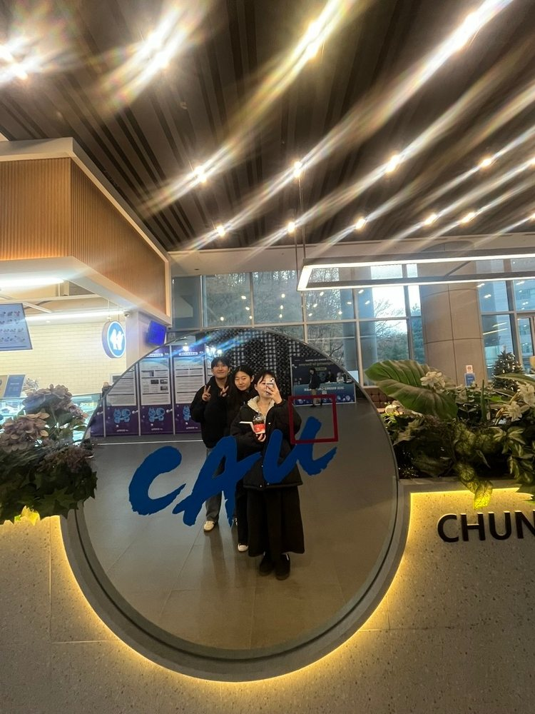

**학교 35** (단서 7개 → 증거 6개)

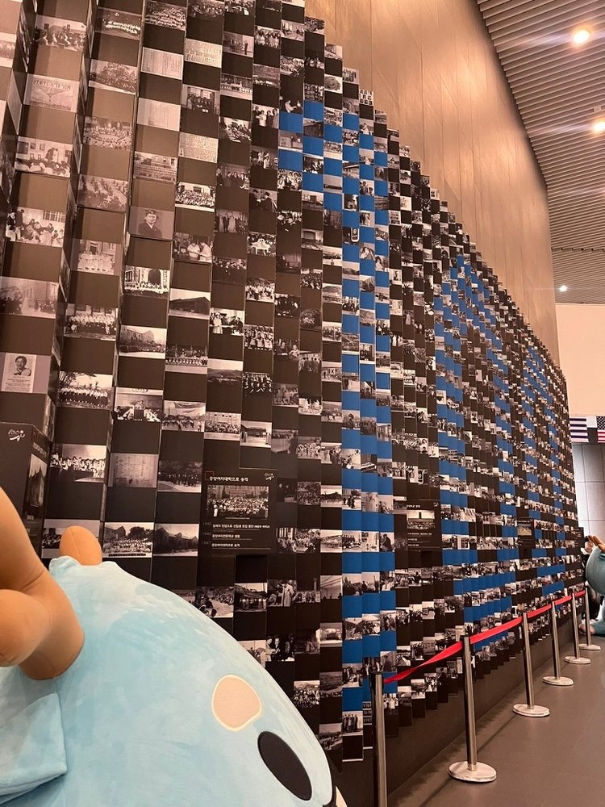

**학교 40** (단서 10개 → 증거 12개)

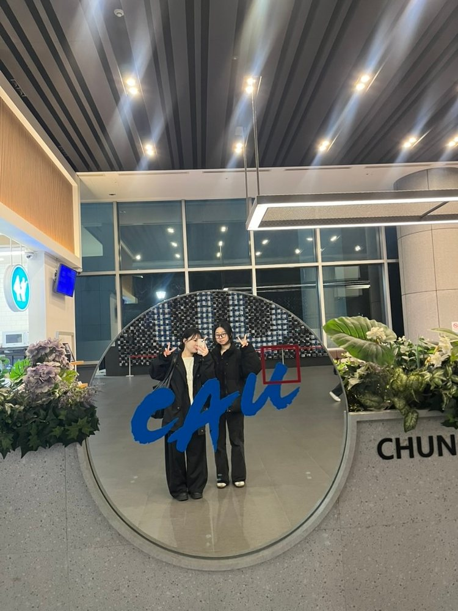

증거 32개 → 고유 단서 20개. 여러 사진에 걸쳐 묶인 단서 10개:

| 묶인 키 | 사진 | 각 사진에서 이 단서가 가리키는 것 | 표시 |
|---|---|---|---|
| `text/CAU` | 4, 40 | **사진 4** `building_sign` (글자 "CAU"): 단서 1 원형 거울에 붓 터치 느낌의 파란색 글자 "CAU"가 빨간색 사각형 윤곽선과 함께 인쇄되어 있으며, 모델은 중앙대학교(한국)의 약칭과 일치한다고 보았습니다. **사진 40** `artwork` (글자 "CAU"): 단서 1 둥근 거울에 손으로 칠한 듯한 큰 파란색 글자 "CAU"가 있고, 오른쪽 벽에는 "CHUN"으로 시작하는 검은색 블록체 글자가 화면 가장자리에서 잘려 있습니다. 모델은 "CHUNG-ANG UNIVERSITY"와 일치한다고 보았습니다. / 단서 5 테라조 벽에 매립된 큰 원형 거울로, 대학 약칭이 가로질러 칠해져 있어 포토 스폿으로 쓰입니다. | — |
| `text/CHUN` | 4, 40 | **사진 4** `building_sign` (글자 "CHUN" (일부만 읽힘)): 단서 2 거울 오른쪽 벽에 어두운 색 돌출 라틴 문자 "CHUN"이 있고 화면 가장자리에서 잘려 있습니다. 모델은 "CHUNG-ANG UNIVERSITY"의 앞부분일 가능성이 높다고 보았습니다. **사진 40** `building_sign` (글자 "CHUN" (일부만 읽힘)): 단서 1 둥근 거울에 손으로 칠한 듯한 큰 파란색 글자 "CAU"가 있고, 오른쪽 벽에는 "CHUN"으로 시작하는 검은색 블록체 글자가 화면 가장자리에서 잘려 있습니다. 모델은 "CHUNG-ANG UNIVERSITY"와 일치한다고 보았습니다. | — |
| `building_sign/appearance` | 4, 40 | **사진 4** `building_sign` (색 blue+red): 단서 1 원형 거울에 붓 터치 느낌의 파란색 글자 "CAU"가 빨간색 사각형 윤곽선과 함께 인쇄되어 있으며, 모델은 중앙대학교(한국)의 약칭과 일치한다고 보았습니다. / 단서 2 거울 오른쪽 벽에 어두운 색 돌출 라틴 문자 "CHUN"이 있고 화면 가장자리에서 잘려 있습니다. 모델은 "CHUNG-ANG UNIVERSITY"의 앞부분일 가능성이 높다고 보았습니다. **사진 40** `building_sign` (색 black): 단서 1 둥근 거울에 손으로 칠한 듯한 큰 파란색 글자 "CAU"가 있고, 오른쪽 벽에는 "CHUN"으로 시작하는 검은색 블록체 글자가 화면 가장자리에서 잘려 있습니다. 모델은 "CHUNG-ANG UNIVERSITY"와 일치한다고 보았습니다. | 종류만 같음 |
| `scene/language/latin` | 4, 40 | **사진 4** `scene` (값 latin): 단서 1 원형 거울에 붓 터치 느낌의 파란색 글자 "CAU"가 빨간색 사각형 윤곽선과 함께 인쇄되어 있으며, 모델은 중앙대학교(한국)의 약칭과 일치한다고 보았습니다. / 단서 2 거울 오른쪽 벽에 어두운 색 돌출 라틴 문자 "CHUN"이 있고 화면 가장자리에서 잘려 있습니다. 모델은 "CHUNG-ANG UNIVERSITY"의 앞부분일 가능성이 높다고 보았습니다. **사진 40** `scene` (값 latin): 단서 1 둥근 거울에 손으로 칠한 듯한 큰 파란색 글자 "CAU"가 있고, 오른쪽 벽에는 "CHUN"으로 시작하는 검은색 블록체 글자가 화면 가장자리에서 잘려 있습니다. 모델은 "CHUNG-ANG UNIVERSITY"와 일치한다고 보았습니다. | 종류만 같음 |
| `banner/appearance` | 4, 35 | **사진 4** `banner` (색 blue+purple): 단서 3 거울에 보라색/파란색 하단 띠가 있는 학술 포스터풍 게시판이 줄지어 있고 파란색 현수막 부스가 비쳐 보여, 모델은 캠퍼스 전시나 행사로 추정했습니다. 글자는 판독되지 않습니다. **사진 35** `banner` (색 red+white): 단서 3 오른쪽 가장자리에 붉은색·흰색 줄무늬와 파란 캔턴이 있는 깃발 일부가 보이며 미국 국기를 닮았습니다. 모델은 줄지어 선 깃발 중 하나일 가능성이 높다고 보았습니다. | 종류만 같음 |
| `interior/appearance` | 4, 35, 40 | **사진 4** `interior` (재질 glass+wood): 단서 4 포토존 거울이 있는 현대식 대학 건물 로비 또는 학생 라운지이며, 왼쪽 위의 메뉴판처럼 보이는 보드로 보아 모델은 카페나 음식 판매대가 있는 것으로 추정했습니다. / 단서 5 높은 천장, 어두운 선형 루버 천장, 목재 루버로 된 박스형 구조물, 큰 유리 커튼월, 원형 콘크리트 기둥을 갖춘 현대적인 실내입니다. **사진 35** `interior` (재질 wood): 단서 4 목재 패널 벽, 매입형 다운라이트가 있는 루버 천장, 광택 있는 어두운 바닥을 갖춘 천장 높은 아트리움으로, 현대식 기관 건물 실내입니다. **사진 40** `interior` (재질 glass): 단서 4 어두운 선형 루버 천장, 천장까지 닿는 유리 커튼월, 패널로 감싼 큰 원형 기둥, 밝은 테라조풍 벽 마감을 갖춘 층고 높은 현대식 로비입니다. 모델은 최근 지어진 한국 대학 건물의 전형이라고 보았습니다. | 종류만 같음 |
| `artwork/appearance` | 4, 35, 40 | **사진 4** `artwork`: 단서 6 천장을 가로지르는 따뜻한 색 줄 조명, 뒤에서 조명이 들어오는 원형 거울 벽감, 수국과 열대 잎 조화 장식이 있고, 오른쪽에는 장식된 작은 크리스마스풍 트리가 있습니다. **사진 35** `artwork` (색 blue+white): 단서 1 사진 벽 안의 어두운 설명 패널에 한국어(한글) 글이 있으며, 단과대학/대학교로 승격된 일 등 기관의 주요 연혁을 설명하는 것으로 보입니다. 모델은 한국으로 판단했습니다. / 단서 2 큐브를 쌓아 만든 대형 역사 벽에 단체 사진, 행사, 옛 건물을 담은 흑백 기록 사진이 있고 사이사이에 파란 큐브가 섞여 있습니다. 모델은 학교나 대학의 기념 연표로 추정했습니다. **사진 40** `artwork` (색 blue, 재질 tile): 단서 1 둥근 거울에 손으로 칠한 듯한 큰 파란색 글자 "CAU"가 있고, 오른쪽 벽에는 "CHUN"으로 시작하는 검은색 블록체 글자가 화면 가장자리에서 잘려 있습니다. 모델은 "CHUNG-ANG UNIVERSITY"와 일치한다고 보았습니다. / 단서 5 테라조 벽에 매립된 큰 원형 거울로, 대학 약칭이 가로질러 칠해져 있어 포토 스폿으로 쓰입니다. / 단서 10 거울에 파란색·검은색·흰색 타일 또는 픽셀풍 모자이크로 덮인 벽이 비치며, 그 앞에 차단봉과 빨간 로프가 놓여 있습니다. | 종류만 같음 |
| `vegetation/appearance` | 4, 40 | **사진 4** `vegetation`: 단서 8 유리벽 너머로 잎이 없는 낙엽수가 보여, 모델은 추운 계절의 온대 기후와 부합한다고 보았습니다. **사진 40** `vegetation`: 단서 6 거울 양옆의 실내 화분에 관상용 또는 인조 수국, 아이비, 흰 꽃, 큰 열대풍 잎이 심겨 있습니다. | 속성 없음, 종류만 같음 |
| `scene/season` | 4, 40 | **사진 4** `scene` (값 winter): 단서 8 유리벽 너머로 잎이 없는 낙엽수가 보여, 모델은 추운 계절의 온대 기후와 부합한다고 보았습니다. / 단서 9 늦가을에서 겨울, 모델은 12월 무렵일 가능성이 높다고 보았으며, 바깥은 흐린 낮이거나 해 질 녘입니다. / 단서 10 어두운 색 패딩 재킷과 롱코트 차림으로, 모델은 동아시아의 추운 날씨와 부합한다고 보았습니다. **사진 40** `scene` (값 winter): 단서 9 거울에 비친 사람들이 어두운색 패딩과 울 재킷, 긴 바지를 입고 있어, 모델은 늦가을에서 초봄 사이로 추정했습니다. | 종류만 같음 |
| `people/appearance` | 4, 40 | **사진 4** `people`: 단서 10 어두운 색 패딩 재킷과 롱코트 차림으로, 모델은 동아시아의 추운 날씨와 부합한다고 보았습니다. **사진 40** `people`: 단서 9 거울에 비친 사람들이 어두운색 패딩과 울 재킷, 긴 바지를 입고 있어, 모델은 늦가을에서 초봄 사이로 추정했습니다. | 속성 없음, 종류만 같음 |

한 사진에만 있는 단서:

- 사진 4: `scene|activity`, `notice|appearance`, `scene|weather`, `building|appearance`
- 사진 35: `scene|language|hangul`, `barrier|appearance`, `other|appearance`
- 사진 40: `shop_sign|appearance`, `lighting|appearance`, `scene|time`

#### C4 · 집_합정 10·12

**집_합정 10** (단서 10개 → 증거 18개)

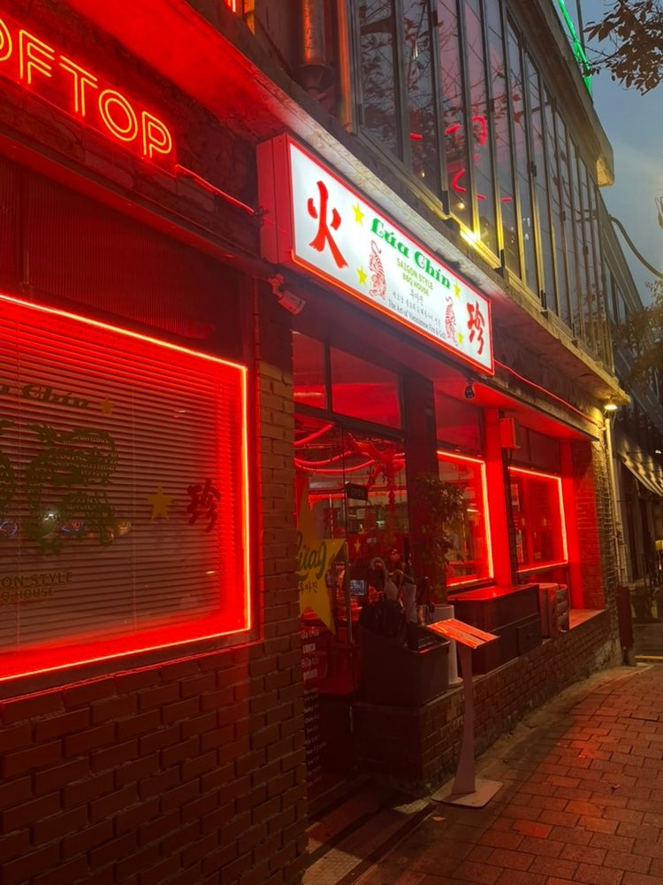

**집_합정 12** (단서 11개 → 증거 18개)

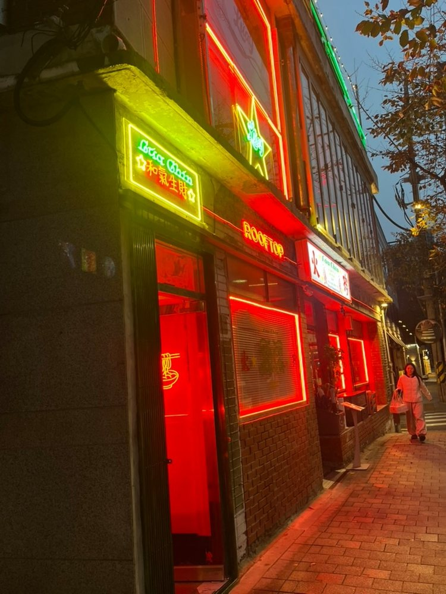

증거 36개 → 고유 단서 24개. 여러 사진에 걸쳐 묶인 단서 12개:

| 묶인 키 | 사진 | 각 사진에서 이 단서가 가리키는 것 | 표시 |
|---|---|---|---|
| `text/火` | 10, 12 | **사진 10** `shop_sign` (글자 "火"): 단서 1 조명이 켜진 흰색 간판에 "Lúa Chín", "Saigon Style BBQ House"라고 적혀 있고, 큰 붉은색 한자 "火", 호랑이 그림, 노란 별이 함께 있으며 같은 로고가 창문 블라인드에도 반복됩니다. 위쪽의 붉은 네온사인은 "...OFTOP"으로 읽히며, … **사진 12** `shop_sign` (글자 "火" (일부만 읽힘)): 단서 1 필기체 라틴 문자 상호("Liu Chin" 비슷하게 읽히는 것으로 보임) 아래에 번체 한자 "和氣生財"가 적힌 네온사인, 빨간색 영어 "ROOFTOP" 간판, 한자 "火"(火鍋, 즉 훠궈일 가능성이 높음)가 보이는 라이트박스가 있습니다. 현지 언어로 된 거리명이나 주소… | — |
| `text/ROOFTOP` | 10, 12 | **사진 10** `shop_sign` (글자 "OFTOP" (일부만 읽힘)): 단서 1 조명이 켜진 흰색 간판에 "Lúa Chín", "Saigon Style BBQ House"라고 적혀 있고, 큰 붉은색 한자 "火", 호랑이 그림, 노란 별이 함께 있으며 같은 로고가 창문 블라인드에도 반복됩니다. 위쪽의 붉은 네온사인은 "...OFTOP"으로 읽히며, … **사진 12** `shop_sign` (글자 "ROOFTOP"): 단서 1 필기체 라틴 문자 상호("Liu Chin" 비슷하게 읽히는 것으로 보임) 아래에 번체 한자 "和氣生財"가 적힌 네온사인, 빨간색 영어 "ROOFTOP" 간판, 한자 "火"(火鍋, 즉 훠궈일 가능성이 높음)가 보이는 라이트박스가 있습니다. 현지 언어로 된 거리명이나 주소… | 읽힌 형태가 다름 |
| `shop_sign/appearance` | 10, 12 | **사진 10** `shop_sign` (색 red+white): 단서 1 조명이 켜진 흰색 간판에 "Lúa Chín", "Saigon Style BBQ House"라고 적혀 있고, 큰 붉은색 한자 "火", 호랑이 그림, 노란 별이 함께 있으며 같은 로고가 창문 블라인드에도 반복됩니다. 위쪽의 붉은 네온사인은 "...OFTOP"으로 읽히며, … / 단서 4 강렬한 붉은색 네온관이 창과 출입구를 둘러싸고 있고, 실내에는 붉은 등과 매달린 장식이 있으며, 문 옆에 노란 별 모양 표지가 있습니다. **사진 12** `shop_sign` (색 green+red): 단서 1 필기체 라틴 문자 상호("Liu Chin" 비슷하게 읽히는 것으로 보임) 아래에 번체 한자 "和氣生財"가 적힌 네온사인, 빨간색 영어 "ROOFTOP" 간판, 한자 "火"(火鍋, 즉 훠궈일 가능성이 높음)가 보이는 라이트박스가 있습니다. 현지 언어로 된 거리명이나 주소… / 단서 2 중국·홍콩풍 테마의 식당 또는 바로, 훠궈와 면 요리를 파는 것으로 보이며(젓가락이 있는 면 그릇 모양 네온 아이콘) 루프톱 좌석 공간이 있습니다. / 단서 3 빨간색, 녹색, 노란색 네온관이 빽빽하게 들어찬 복고풍 홍콩 스타일이며 네온 별도 있습니다. 모델은 동아시아의 유행하는 유흥가에 있는 테마 업소에서 흔한 모습이라고 보았습니다. | 종류만 같음 |
| `scene/language/latin` | 10, 12 | **사진 10** `scene` (값 latin): 단서 1 조명이 켜진 흰색 간판에 "Lúa Chín", "Saigon Style BBQ House"라고 적혀 있고, 큰 붉은색 한자 "火", 호랑이 그림, 노란 별이 함께 있으며 같은 로고가 창문 블라인드에도 반복됩니다. 위쪽의 붉은 네온사인은 "...OFTOP"으로 읽히며, … / 단서 2 성조 부호가 있는 베트남어 상호, 영어 문구("The Art of Vietnamese Pork & Grill"), 한자, 그리고 간판과 출입구 옆 노란 별 모양 표지에 작은 한글이 있습니다. 모델은 한국으로 추정했습니다. **사진 12** `scene` (값 latin): 단서 1 필기체 라틴 문자 상호("Liu Chin" 비슷하게 읽히는 것으로 보임) 아래에 번체 한자 "和氣生財"가 적힌 네온사인, 빨간색 영어 "ROOFTOP" 간판, 한자 "火"(火鍋, 즉 훠궈일 가능성이 높음)가 보이는 라이트박스가 있습니다. 현지 언어로 된 거리명이나 주소… | 종류만 같음 |
| `scene/language/han` | 10, 12 | **사진 10** `scene` (값 han): 단서 1 조명이 켜진 흰색 간판에 "Lúa Chín", "Saigon Style BBQ House"라고 적혀 있고, 큰 붉은색 한자 "火", 호랑이 그림, 노란 별이 함께 있으며 같은 로고가 창문 블라인드에도 반복됩니다. 위쪽의 붉은 네온사인은 "...OFTOP"으로 읽히며, … / 단서 2 성조 부호가 있는 베트남어 상호, 영어 문구("The Art of Vietnamese Pork & Grill"), 한자, 그리고 간판과 출입구 옆 노란 별 모양 표지에 작은 한글이 있습니다. 모델은 한국으로 추정했습니다. **사진 12** `scene` (값 han): 단서 1 필기체 라틴 문자 상호("Liu Chin" 비슷하게 읽히는 것으로 보임) 아래에 번체 한자 "和氣生財"가 적힌 네온사인, 빨간색 영어 "ROOFTOP" 간판, 한자 "火"(火鍋, 즉 훠궈일 가능성이 높음)가 보이는 라이트박스가 있습니다. 현지 언어로 된 거리명이나 주소… | 종류만 같음 |
| `building/appearance` | 10, 12 | **사진 10** `building` (재질 brick+glass): 단서 5 2~3층 규모의 저층 상업 건물로, 어두운 벽돌 외벽, 위층의 여러 칸짜리 대형 유리창, 노출된 금속 배기 덕트, 벽에 부착된 CCTV 카메라가 있습니다. **사진 12** `building` (재질 brick+stone): 단서 4 2~3층짜리 저층 복합용도 건물로, 외벽은 어두운 색 유약 벽돌이고 옆 벽은 어두운 광택 화강암으로 마감되어 있습니다. 위층에는 큰 창이 있고 줄전구가 달린 루프톱 테라스가 있습니다. | 종류만 같음 |
| `utility/appearance` | 10, 12 | **사진 10** `utility` (재질 metal): 단서 5 2~3층 규모의 저층 상업 건물로, 어두운 벽돌 외벽, 위층의 여러 칸짜리 대형 유리창, 노출된 금속 배기 덕트, 벽에 부착된 CCTV 카메라가 있습니다. / 단서 9 건물 외벽을 따라 가공 케이블과 전선이 지나갑니다. **사진 12** `utility`: 단서 7 전신주에 전선 다발이 묶인 가공 전력선·통신선이 있습니다. 모델은 한국, 일본 또는 대만의 오래된 동네에서 흔한 모습이라고 보았습니다. | 종류만 같음 |
| `pavement/appearance` | 10, 12 | **사진 10** `pavement` (색 grey+red, 재질 brick): 단서 6 좁은 보행자 보도에 붉은색과 회색의 맞물림식 벽돌 포장 블록이 깔려 있습니다. 모델은 서울의 상업 지역에서 흔한 형태라고 보았습니다. **사진 12** `pavement` (색 red, 재질 brick): 단서 5 좁은 보도에 불그스름한 맞물림 벽돌 블록이 깔려 있으며, 모델은 한국 도시에서 흔한 포장 방식이라고 보았습니다. | 종류만 같음 |
| `street_furniture/appearance` | 10, 12 | **사진 10** `street_furniture`: 단서 7 보도에 세워 둔 메뉴 스탠드가 있고, 출입구 옆에 화분 상자와 작은 벤치 또는 상자형 좌석이 있습니다. **사진 12** `street_furniture` (색 black+yellow): 단서 6 배경에 노란색·검은색 줄무늬 기둥 또는 볼라드와 횡단보도가 보이고, 입구 밖에는 작은 입간판 메뉴판이 서 있습니다. | 종류만 같음 |
| `vegetation/appearance` | 10, 12 | **사진 10** `vegetation`: 단서 7 보도에 세워 둔 메뉴 스탠드가 있고, 출입구 옆에 화분 상자와 작은 벤치 또는 상자형 좌석이 있습니다. / 단서 8 오른쪽 위에 낙엽성 가로수의 가지가 보이고 문 옆에 화분 식물이 있습니다. 모델은 온대 기후로 판단했습니다. **사진 12** `vegetation` (색 brown+yellow): 단서 8 갈색과 노란색 잎이 달린 낙엽 가로수가 있습니다. 모델은 온대 기후의 늦가을로 판단했습니다. | 종류만 같음 |
| `scene/time` | 10, 12 | **사진 10** `scene` (값 dusk): 단서 10 하늘이 푸른 해 질 녘 또는 이른 저녁이며, 유흥가와 식당가의 분위기입니다. 모델은 대한민국 서울(예: 용산/삼각지, 이태원, 성수, 홍대와 같은 유형의 지역)일 가능성이 가장 높지만, 사진만으로는 정확한 주소를 특정할 수 없다고 판단했습니다. **사진 12** `scene` (값 dusk): 단서 10 해 질 녘 또는 초저녁으로, 하늘은 파랗고 네온 조명이 이미 켜져 있습니다. | 종류만 같음 |
| `sky/appearance` | 10, 12 | **사진 10** `sky` (색 blue): 단서 10 하늘이 푸른 해 질 녘 또는 이른 저녁이며, 유흥가와 식당가의 분위기입니다. 모델은 대한민국 서울(예: 용산/삼각지, 이태원, 성수, 홍대와 같은 유형의 지역)일 가능성이 가장 높지만, 사진만으로는 정확한 주소를 특정할 수 없다고 판단했습니다. **사진 12** `sky` (색 blue): 단서 10 해 질 녘 또는 초저녁으로, 하늘은 파랗고 네온 조명이 이미 켜져 있습니다. | 종류만 같음 |

한 사진에만 있는 단서:

- 사진 10: `text|LUACHIN`, `text|SAIGONSTYLEBBQHOUSE`, `text|THEARTOFVIETNAMESEPORKGRILL`, `scene|language|hangul`, `scene|activity`, `lighting|appearance`
- 사진 12: `text|和氣生財`, `text|LIUCHIN`, `road|appearance`, `scene|season`, `people|appearance`, `scene|layout`

#### C5 · 학교 2·32

**학교 2** (단서 10개 → 증거 16개)

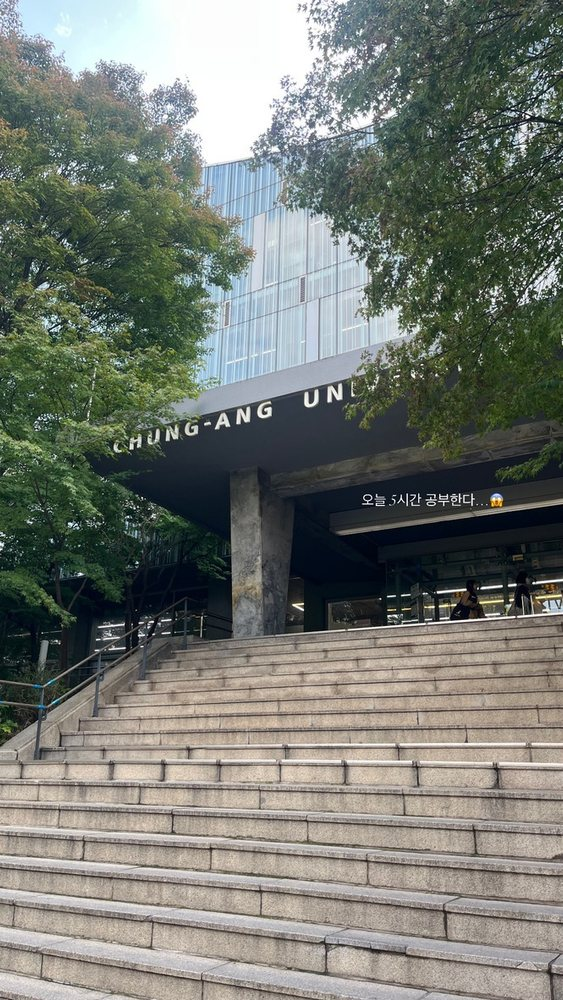

**학교 32** (단서 12개 → 증거 14개)

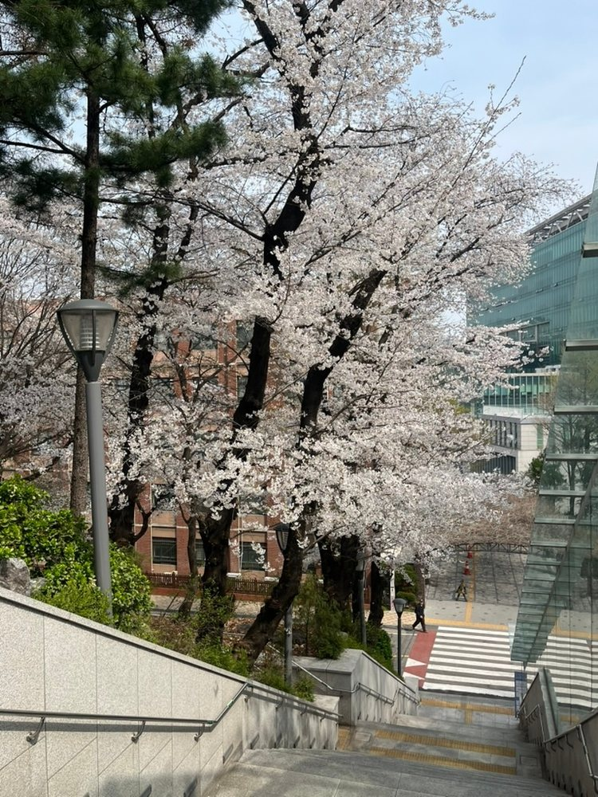

증거 30개 → 고유 단서 21개. 여러 사진에 걸쳐 묶인 단서 9개:

| 묶인 키 | 사진 | 각 사진에서 이 단서가 가리키는 것 | 표시 |
|---|---|---|---|
| `building/appearance` | 2, 32 | **사진 2** `building` (색 blue+green, 재질 glass+stone): 단서 3 1층에 넓은 유리 출입구가 있는 대형 대학 건물로, 모델은 학생들이 공부하는 중앙도서관이나 주요 강의동일 가능성이 높다고 보았습니다. / 단서 4 현대식으로 리모델링된 건물로, 거친 석재로 마감된 기둥이 받치는 어두운 캔틸레버 캐노피 위에 반투명 청록색 세로 유리 패널로 덮인 상부 박스가 얹혀 있습니다. 모델은 중앙대학교 서울캠퍼스의 리모델링된 중앙도서관과 일치한다고 보았습니다. **사진 32** `building` (색 green+red, 재질 brick+glass): 단서 3 규칙적인 직사각형 창이 있는 다층 붉은 벽돌 기관 또는 학술 건물 옆에, 노출된 철골 지붕 구조와 유리 캐노피를 갖춘 녹색빛 유리 커튼월의 현대식 건물이 있습니다. / 단서 4 계단 벽과 화단의 연회색 광택 화강석 마감, 화강석 계단, 스테인리스 스틸 부속, 붉은 벽돌 외벽, 색유리가 보입니다. | 종류만 같음 |
| `pavement/appearance` | 2, 32 | **사진 2** `pavement` (색 beige+grey, 재질 stone): 단서 5 출입구로 이어지는 넓은 밝은 회색/베이지색 화강암 계단으로, 한국의 캠퍼스와 공공건물 진입부에서 흔히 볼 수 있는 형태입니다. **사진 32** `pavement` (색 yellow): 단서 6 계단 상단과 계단참에 노란색 점자 경고 블록이 깔려 있습니다. 모델은 한국과 일본에서 표준적인 시설이라고 보았습니다. | 종류만 같음 |
| `barrier/appearance` | 2, 32 | **사진 2** `barrier` (색 blue+grey, 재질 metal): 단서 6 계단 왼쪽과 경사로/계단참을 따라 파란색 포인트 띠가 들어간 회색 금속 난간이 있고, 출입구 너머로 실내 형광등 조명이 보입니다. **사진 32** `barrier` (재질 metal+wood): 단서 4 계단 벽과 화단의 연회색 광택 화강석 마감, 화강석 계단, 스테인리스 스틸 부속, 붉은 벽돌 외벽, 색유리가 보입니다. / 단서 5 원뿔형 갓을 씌운 등롱 모양 등기구의 회색 가로등, 벽에 부착된 스테인리스 스틸 난간, 식재 구역을 두른 낮은 나무 울타리가 있습니다. | 종류만 같음 |
| `lighting/appearance` | 2, 32 | **사진 2** `lighting`: 단서 6 계단 왼쪽과 경사로/계단참을 따라 파란색 포인트 띠가 들어간 회색 금속 난간이 있고, 출입구 너머로 실내 형광등 조명이 보입니다. **사진 32** `lighting` (색 grey): 단서 5 원뿔형 갓을 씌운 등롱 모양 등기구의 회색 가로등, 벽에 부착된 스테인리스 스틸 난간, 식재 구역을 두른 낮은 나무 울타리가 있습니다. | 종류만 같음 |
| `vegetation/appearance` | 2, 32 | **사진 2** `vegetation` (색 green): 단서 7 단풍나무와 느티나무로 보이는 활엽 낙엽수가 계단을 둘러싸고 있으며, 무성한 녹색 잎에 이른 단풍 기미가 약간 있습니다. 온대 동아시아 기후입니다. / 단서 10 밝고 뿌연 낮의 햇빛, 맑거나 구름이 조금 낀 하늘, 무성한 잎으로 보아 모델은 북반구의 늦여름에서 초가을(9월 무렵)로 판단했습니다. **사진 32** `vegetation`: 단서 1 만개한 큰 벚나무들과 붉은빛의 굽은 줄기를 가진 키 큰 적송, 다듬어진 상록 관목이 함께 있습니다. 모델은 한국과 일본에서 흔한 식재 조합이라고 보았습니다. / 단서 2 벚꽃이 절정이고 봄 새잎이 돋았으며 하늘은 뿌연 파란색입니다. 모델은 온대 동아시아 기후의 4월 초~중순으로 판단했습니다. | 종류만 같음 |
| `terrain/appearance` | 2, 32 | **사진 2** `terrain`: 단서 8 건물이 촬영자보다 높은 오르막 지형 위에 있고 긴 계단으로 이어져 있어, 모델은 서울 흑석동의 언덕 캠퍼스와 부합한다고 보았습니다. **사진 32** `terrain`: 단서 8 뚜렷한 경사가 있고 긴 계단이 아래쪽 광장으로 내려갑니다. 모델은 언덕진 도시 부지로 추정했습니다. | 속성 없음, 종류만 같음 |
| `scene/activity` | 2, 32 | **사진 2** `scene`: 단서 9 계단 위 출입구 근처에 가방을 든 사람 몇 명이 있어, 모델은 캠퍼스 도서관에 들어가는 학생들과 부합한다고 보았습니다. **사진 32** `scene`: 단서 11 어두운 색의 가벼운 봄옷을 입은 몇 사람이 광장을 가로질러 걷고 있으며, 구별되는 특징은 없습니다. | 종류만 같음 |
| `scene/weather` | 2, 32 | **사진 2** `scene` (값 clear): 단서 10 밝고 뿌연 낮의 햇빛, 맑거나 구름이 조금 낀 하늘, 무성한 잎으로 보아 모델은 북반구의 늦여름에서 초가을(9월 무렵)로 판단했습니다. **사진 32** `scene` (값 clear): 단서 2 벚꽃이 절정이고 봄 새잎이 돋았으며 하늘은 뿌연 파란색입니다. 모델은 온대 동아시아 기후의 4월 초~중순으로 판단했습니다. | 종류만 같음 |
| `scene/season` | 2, 32 | **사진 2** `scene` (값 autumn): 단서 10 밝고 뿌연 낮의 햇빛, 맑거나 구름이 조금 낀 하늘, 무성한 잎으로 보아 모델은 북반구의 늦여름에서 초가을(9월 무렵)로 판단했습니다. **사진 32** `scene` (값 spring): 단서 1 만개한 큰 벚나무들과 붉은빛의 굽은 줄기를 가진 키 큰 적송, 다듬어진 상록 관목이 함께 있습니다. 모델은 한국과 일본에서 흔한 식재 조합이라고 보았습니다. / 단서 2 벚꽃이 절정이고 봄 새잎이 돋았으며 하늘은 뿌연 파란색입니다. 모델은 온대 동아시아 기후의 4월 초~중순으로 판단했습니다. | 종류만 같음 |

한 사진에만 있는 단서:

- 사진 2: `text|CHUNGANGUN`, `building_sign|appearance`, `scene|language|latin`, `text|오늘5시간공부한다`, `scene|language|hangul`, `scene|layout`, `scene|time`
- 사진 32: `sky|appearance`, `other|appearance`, `road|appearance`, `street_furniture|appearance`, `people|appearance`

#### C6 · 학교 12·22

**학교 12** (단서 9개 → 증거 14개)

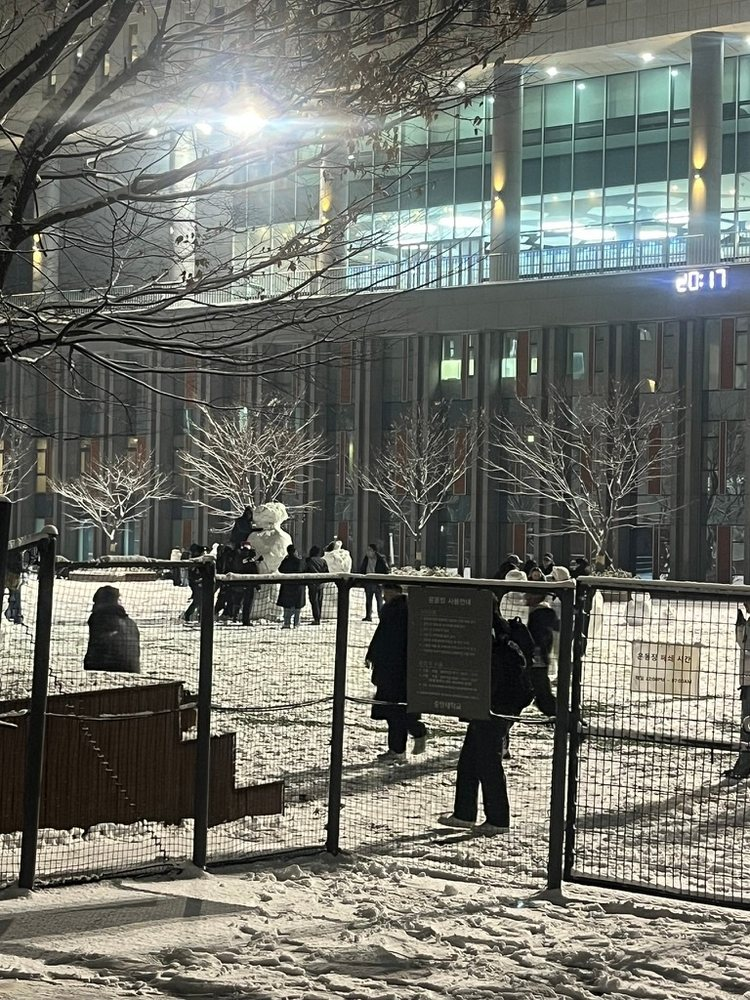

**학교 22** (단서 16개 → 증거 12개)

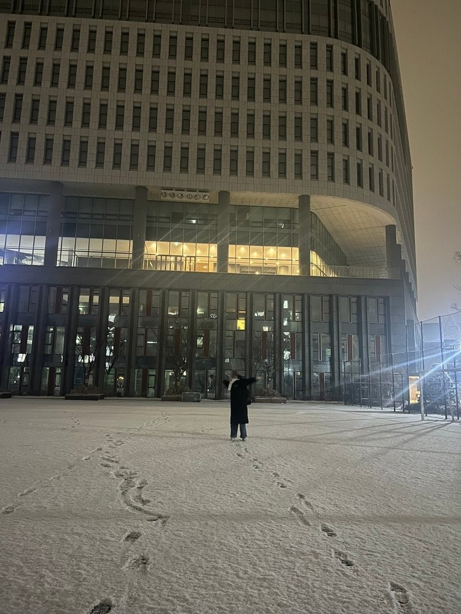

증거 26개 → 고유 단서 18개. 여러 사진에 걸쳐 묶인 단서 8개:

| 묶인 키 | 사진 | 각 사진에서 이 단서가 가리키는 것 | 표시 |
|---|---|---|---|
| `building/appearance` | 12, 22 | **사진 12** `building` (색 brown+red, 재질 glass): 단서 2 여러 층 높이의 유리 커튼월, 따뜻한 색 벽등이 달린 높은 원통형 기둥, 난간이 있는 테라스, 좁은 창 사이에 붉은색/갈색 세로 패널이 들어간 저층부 외벽을 갖춘 대형 현대식 기관 건물입니다. **사진 22** `building` (색 beige, 재질 glass+stone): 단서 1 현대적인 대규모 기관 건축으로, 유리 커튼월 포디움 위에 석재로 마감한 상층부가 얹힌 완만하게 휘어진 곡면 외벽입니다. 모델은 현대 동아시아 캠퍼스/공공 건물에서 흔한 양식이라고 판단했습니다. / 단서 2 모델은 대학, 학교 또는 공공/오피스 복합 건물일 가능성이 높다고 판단했습니다. 저층부 위에 밝게 불 켜진 공용 층(로비, 도서관 또는 식당 같은 공간)이 있습니다. / 단서 3 상층부는 연한 베이지색 석재 또는 프리캐스트 패널에 좁은 세로 창이 규칙적인 격자를 이루고, 저층부는 유리에 어두운 수직 핀과 붉은색/갈색 포인트 패널이 있으며, 큰 원형 기둥이 있습니다. / 단서 4 보이는 층수만 10층 이상인 매우 큰 고층 또는 중층 건물로, 평면이 오목하게/곡선으로 휘어 있고 돌출된 상부 매스 아래에 난간이 있는 후퇴된 테라스 층이 있습니다. / 단서 12 테라스 층 위 외벽에 둥근 환기/배기 팬이 한 줄로 설치되어 있습니다. | 종류만 같음 |
| `barrier/appearance` | 12, 22 | **사진 12** `barrier` (재질 metal): 단서 4 금속 기둥과 출입문이 있는 어두운 색 철망 울타리가 탁 트인 운동장을 둘러싸고 있고, 가장자리에 낮은 목재 계단식 좌석이 있습니다. 모델은 캠퍼스 운동장이나 경기장과 일치한다고 판단했습니다. **사진 22** `barrier` (재질 metal): 단서 9 오른쪽에 기둥이 있는 높은 메시/철망 울타리가 있습니다. 모델은 학교나 캠퍼스 마당 옆의 울타리 친 운동 코트나 놀이터에서 전형적인 것이라고 판단했습니다. | 종류만 같음 |
| `scene/weather` | 12, 22 | **사진 12** `scene` (값 snow): 단서 5 땅과 나뭇가지에 갓 내린 눈이 덮여 있습니다. 모델은 추운 온대 지역의 겨울로, 12월에서 2월 사이일 가능성이 높다고 판단했습니다. / 단서 6 건물 앞에 줄지어 심은 작은 관상수를 포함해 잎이 진 낙엽수들이 모두 눈에 덮여 있습니다. **사진 22** `scene` (값 snow): 단서 5 갓 내린 눈이 몇 센티미터 쌓여 있고 눈으로 공기가 뿌옇습니다. 모델은 겨울이 춥고 눈이 자주 오는 지역(온대/대륙성 기후)으로 판단했습니다. | 종류만 같음 |
| `scene/season` | 12, 22 | **사진 12** `scene` (값 winter): 단서 5 땅과 나뭇가지에 갓 내린 눈이 덮여 있습니다. 모델은 추운 온대 지역의 겨울로, 12월에서 2월 사이일 가능성이 높다고 판단했습니다. / 단서 6 건물 앞에 줄지어 심은 작은 관상수를 포함해 잎이 진 낙엽수들이 모두 눈에 덮여 있습니다. / 단서 7 어두운 색 패딩 겨울 외투를 입은 주로 젊은 사람들이 무리 지어 운동장에서 큰 눈사람을 만들고 사진을 찍고 있습니다. 모델은 학생들이 많은 곳임을 시사한다고 판단했습니다. **사진 22** `scene` (값 winter): 단서 5 갓 내린 눈이 몇 센티미터 쌓여 있고 눈으로 공기가 뿌옇습니다. 모델은 겨울이 춥고 눈이 자주 오는 지역(온대/대륙성 기후)으로 판단했습니다. / 단서 6 겨울 밤이며, 나무에 잎이 없습니다. / 단서 16 뒷모습이 보이는 한 사람이 긴 어두운 색 패딩/모직 코트와 밝은 색 목도리를 착용하고 있습니다. 모델은 추운 겨울 날씨와 일치한다고 판단했습니다. | 종류만 같음 |
| `vegetation/appearance` | 12, 22 | **사진 12** `vegetation`: 단서 6 건물 앞에 줄지어 심은 작은 관상수를 포함해 잎이 진 낙엽수들이 모두 눈에 덮여 있습니다. **사진 22** `vegetation`: 단서 6 겨울 밤이며, 나무에 잎이 없습니다. / 단서 7 건물 앞을 따라 놓인 낮은 사각 석재 화단에 잎이 없는 작은 낙엽수가 있으며, 상록수나 열대 식생은 보이지 않습니다. | 속성 없음, 종류만 같음 |
| `people/appearance` | 12, 22 | **사진 12** `people`: 단서 7 어두운 색 패딩 겨울 외투를 입은 주로 젊은 사람들이 무리 지어 운동장에서 큰 눈사람을 만들고 사진을 찍고 있습니다. 모델은 학생들이 많은 곳임을 시사한다고 판단했습니다. **사진 22** `people` (재질 fabric): 단서 16 뒷모습이 보이는 한 사람이 긴 어두운 색 패딩/모직 코트와 밝은 색 목도리를 착용하고 있습니다. 모델은 추운 겨울 날씨와 일치한다고 판단했습니다. | 종류만 같음 |
| `scene/time` | 12, 22 | **사진 12** `scene` (값 night): 단서 8 밝은 투광등 또는 가로등과 건물 실내 조명이 비추는 야간 장면이며, 시계에 따르면 시각은 20:17입니다. **사진 22** `scene` (값 night): 단서 6 겨울 밤이며, 나무에 잎이 없습니다. / 단서 15 주황빛이 도는 갈색의 흐린 밤하늘입니다. 모델은 대도시에서 눈구름에 반사된 심한 도시 광공해를 나타낸다고 판단했습니다. | 종류만 같음 |
| `lighting/appearance` | 12, 22 | **사진 12** `lighting`: 단서 8 밝은 투광등 또는 가로등과 건물 실내 조명이 비추는 야간 장면이며, 시계에 따르면 시각은 20:17입니다. **사진 22** `lighting` (색 white+yellow): 단서 10 오른쪽 기둥의 강한 흰색 투광등이 렌즈 플레어를 만들고 있고, 테라스 층에는 따뜻한 노란색 실내조명이, 저층부에는 차가운 흰색 조명이 켜져 있습니다. | 종류만 같음 |

한 사진에만 있는 단서:

- 사진 12: `scene|language|hangul`, `notice|appearance`, `text|2017`, `sports_facility|appearance`, `street_furniture|appearance`, `scene|activity`
- 사진 22: `open_space|appearance`, `interior|appearance`, `scene|layout`, `sky|appearance`

