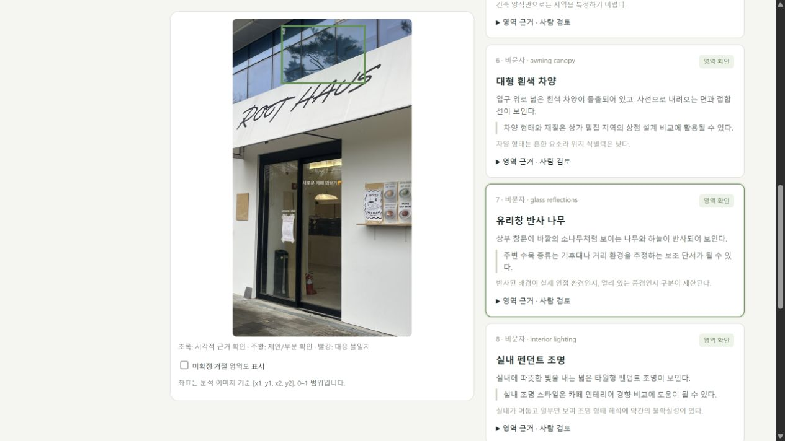

# 실제 사진 단서 추출 검증

사용자가 제공한 `KakaoTalk_20261101_221748649_09.jpg`로 새 Research Cue Lab을 실행했다. 합성 이미지를 대신 사용하지 않았다. 기능 경로인 사진 입력 → 문자·비문자 발견 → 영역 검출 및 검토 → SQLite 저장 → JSON 다운로드는 작동한다. 다만 지리적 관련성 판정에는 오판이 남아 있어 추출 품질 문제가 완전히 해결되었다고 판단할 수는 없다.

최종 기록 ID: `de0ae180-c9ed-4126-815b-fc68e0be48a9`

## 실행 결과

| 항목 | 결과 |
|---|---:|
| 독립 VLM 발견 후보 | 10개: 문자 4, 비문자 6 |
| OCR 원본 영역 | 33개 |
| 보존한 전체 관찰 레코드 | 43개 |
| 관련성 판정 | 후보 28, 보류 2, 무관 13 |
| 영역 상태가 supported인 관찰 | 14개 |
| 최종 파이프라인 상태 | completed, errors 없음 |

33개 OCR에는 중복과 대체 판독이 포함된다. VLM 발견과 OCR 관찰도 독립 출처로 보존한다. 따라서 43은 독립 단서 수가 아니며, 14/43은 정확도가 아니다. `supported`는 모델이 crop의 시각적 대응을 지지했다는 뜻으로, 사람 정답이나 지리적 고유성을 입증하지 않는다. `completed` 역시 단계 완료를 뜻하며 모든 의미 판단의 정확성을 뜻하지 않는다.

## 이 사진에서 나온 단서

| 구분 | 관찰 | 영역 검토 |
|---|---|---|
| 문자 | ROOT HAUS 외부 간판 | supported |
| 문자 | 영업시간 안내문 | supported; 원문 판독 충돌은 별도 검토 필요 |
| 문자 | 카페 홍보 포스터 | partial |
| 문자 | 빵 메뉴 안내판 | supported; 일반 메뉴명의 지리적 관련성과 구분 필요 |
| 비문자 | 흰 외벽과 큰 유리면 | supported |
| 비문자 | 큰 흰색 차양 | supported |
| 비문자 | 창문에 반사된 나무 | supported |
| 비문자 | 실내 펜던트 조명 | supported |
| 비문자 | 소화기 | supported |
| 비문자 | 출입구 바닥 배수·마감 경계 | supported |

비문자 객체가 눈에 보인다는 사실만으로 강한 위치 단서가 되지는 않는다. 조명·소화기 등은 장면 대조에 사용할 수 있는 후보이며 지역 고유성은 확인하지 않았다. 실제 주소·도시·좌표를 추정하거나 외부에서 상호를 검색하지 않았다.

## 논문 이식 범위

[DoxBench의 GeoMiner detector](https://github.com/SaFo-Lab/DoxBench/blob/main/code/experiment/experiment.py#L215-L247)에서 범주와 상세 단서를 개방형으로 발견하는 방식을 적용했다. Beyond the Geotag 첨부 코드의 텍스트 가치 구분은 일반 문구·공유 브랜드·지역/연락 식별자·구체적 장소 문자열을 구별하는 정성 기준으로 옮겼다. 원문의 숫자 점수와 불명확한 State 매핑을 지리적 위험 확률로 사용하지 않았다.

두 자료의 프롬프트 자체는 DB 계약, bbox의 단서별 연결, 영역 검증, OCR 누락·중복 처리까지 제공하지 않는다. 새 구현이 JSON Schema, PaddleOCR, 질의별 Grounding DINO, crop 검토, SQLite, 원본 응답 보존, 사람 검토를 추가한다. 원문 그대로의 재현 실험은 아니다. 자세한 소스 점검은 `kkokkkok-application-analysis.md`와 `source-audit.json`에 있다.

## 이번에 수정한 오류 처리

- OCR을 ID별로 표시한 문맥 crop을 8개씩 검토해 ID 누락·중복을 줄였다. 응답의 누락·중복은 보류로 남긴다.
- 같은 상호 문자열만으로 서로 다른 표지판을 하나의 증거로 합치지 않는다. 독립 발견과 OCR의 연결도 별도로 검증한다.
- 지리적 관련성이 없다는 판정을 bbox가 틀렸다는 판정과 분리했다. 해당 OCR의 영역 상태는 `not_assessed`다.
- 검증이 모호하거나 누락되면 부분 확인으로 남긴다. 원문 응답을 올바른 결과처럼 바꾸지 않는다.
- 저장된 원본 artifacts를 보존하고 파생 cues만 갱신했다. 최종 파생 버전은 `cue-projection-v2`다.

## 남은 품질 문제와 다음 평가 기준

1. 화면에 덧붙인 “새로운 카페 와보기” 자막을 모델이 물리적인 고정 표지처럼 해석한 사례가 남아 있다. 자막·반사·사진 속 사진·차량 광고를 포함한 검증 세트로 surface 판정을 별도로 평가해야 한다.
2. 일반 메뉴명과 영업시간을 위치 후보로 과하게 인정하는 응답이 남아 있다. 프롬프트에 제외 기준이 있어도 준수가 보장되지 않는다. 단서의 가시성, 물리적 출처, 지리적 관련성을 각각 채점해야 한다.
3. 영업시간 원문에 VLM의 `18:00`과 OCR의 `08:00`처럼 충돌하는 판독이 있다. 원문은 모두 보존하며 사람 정답 없이 하나를 확정하지 않는다.
4. 출입문 포스터 후보의 영역이 오른쪽 메뉴판을 가리키는 사례는 부분 확인으로 남았다. 상호 문자열 일치와 같은 물리적 표지판의 대응을 구분해야 한다.
5. 이 한 장에는 수작업 정답 전체가 없으므로 precision/recall, bbox IoU, 누락률을 산출하지 않았다. 다양한 사진에 문자·비문자 정답과 영역을 표시한 뒤 기존 PoC와 같은 입력·정답으로 비교해야 한다.

실사용에서 자동 확정할 기준을 세우려면 위 평가가 필요하다. 현재 UI의 사람 검토는 모델 판단과 별도 저장된다. 이 결과에 맞춘 예외 규칙으로 일반화 성능이 개선되었다고 주장하지 않는다.

## 저장·영역·검증

결과는 `photo-test-result.json`, 요약은 `photo-test-summary.json`, DB는 `location-cue-lab/private-data/cues.sqlite`다. bbox는 EXIF 방향을 반영한 분석 이미지 기준 0–1 정규화 xyxy이고 OCR polygon도 보존한다. SAM은 구현하지 않았으며 `mask:null`이다. 요구사항의 bbox 경로를 구현했다.

최종 코드에서 자동 테스트 10개와 JavaScript 구문 검사 12개 파일이 통과했다. 자동 테스트의 모델 응답은 모의 데이터이며, 이 보고서의 사진 결과는 실제 모델·OCR·DINO 실행 결과다. 브라우저에서 실제 사진, 비문자 필터, 단서 선택과 bbox 대응, JSON 다운로드를 확인했다. 내려받은 JSON과 결과 파일은 파싱 후 전체 구조가 동일했다. 이번 마무리 단계에서는 모델 API를 추가 호출하지 않았다.

실행은 `location-cue-lab/README.md`를 따른다. 서버 실행 중에는 <http://127.0.0.1:3210/#de0ae180-c9ed-4126-815b-fc68e0be48a9>에서 저장된 결과를 다시 볼 수 있다.

