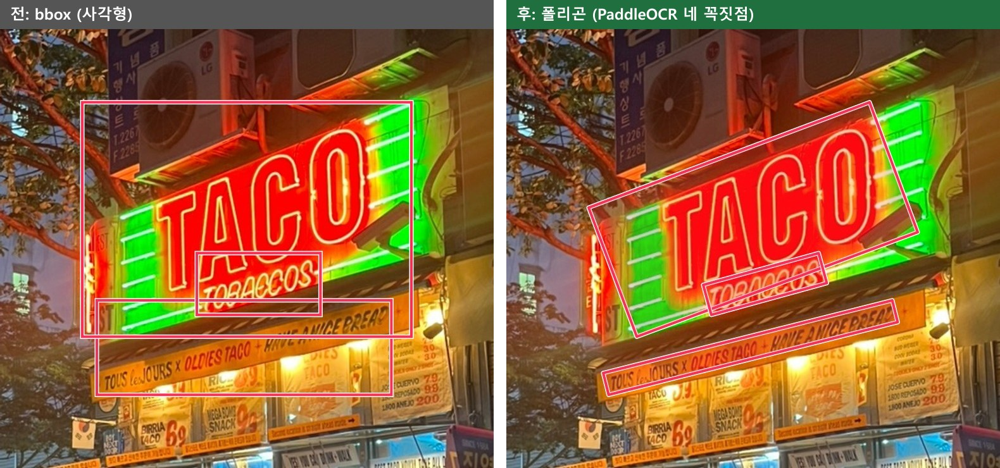
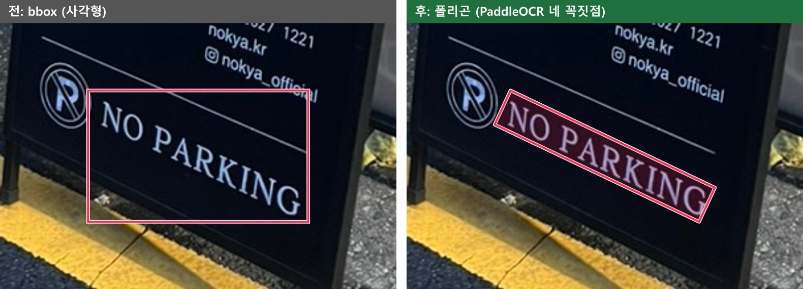
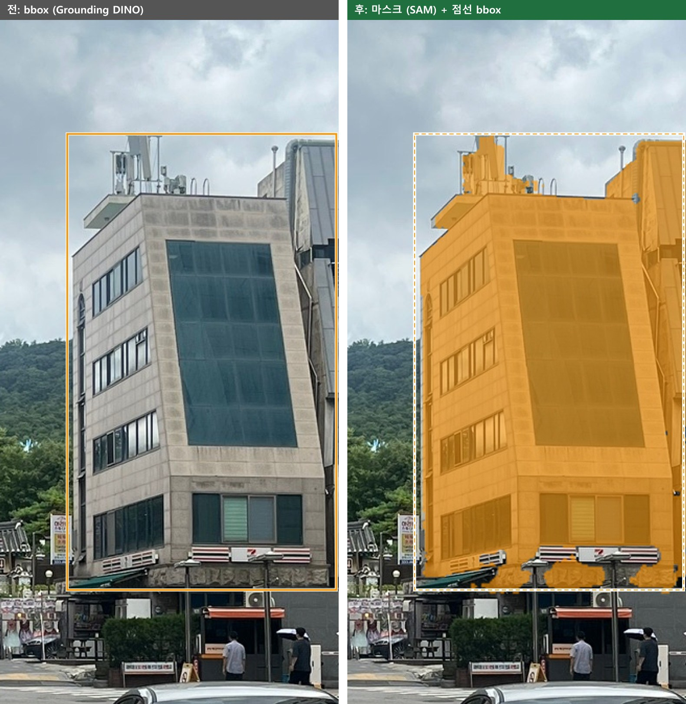
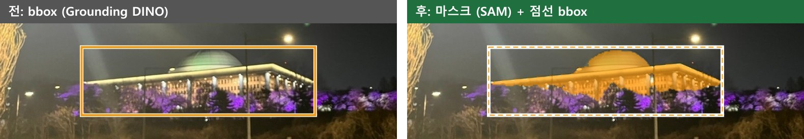
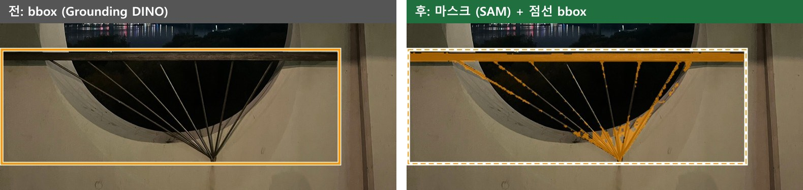

# 단서 영역 표현 변경: bbox → 폴리곤·마스크

단서의 위치를 사각형(bbox) 하나로만 그리던 것을, 글자는 폴리곤으로, 물체는 마스크로 바꾼 내용을 전·후 사진 5장과 함께 정리했습니다. 보고서 작성일은 2026-11-17입니다.

## 2026-11-16

### 요약

| | 글자 단서 | 물체 단서 |
|---|---|---|
| 작업일 | 2026-11-16 | 2026-11-16 |
| 전 | PaddleOCR 줄을 둘러싼 사각형 | Grounding DINO 사각형 |
| 후 | 폴리곤 (네 꼭짓점 윤곽) | 마스크 (물체 모양대로 칠함) + 점선 사각형 |
| 쓴 기술 | PaddleOCR이 원래 돌려주던 꼭짓점 좌표. 새 도구 없음 | Segment Anything (`facebook/sam-vit-base`). DINO 사각형을 프롬프트로 넘김 |
| 추가 실행 시간 | 없음 | 사진당 약 9초 (CPU, 워커 상주 기준) |
| 적용 범위 | 뷰어와 미리보기의 모든 글자 영역 | 위치가 드러난 사진 중 물체 상자가 있는 35장, 마스크 150개 |
| 기록에 남는 것 | 이미 저장돼 있던 `polygon` | region에 `mask` 추가 (긴 변 512, 연속 길이 압축) |

두 경우 모두 `bbox`는 기록에 그대로 남아 있고, 위험 판정·중복 제거 계산은 계속 `bbox`를 씁니다. 바뀐 것은 화면에 그리는 모양과, 물체 영역에 새로 붙은 `mask` 데이터입니다.

그림 보는 법:

- 왼쪽이 전(사각형), 오른쪽이 후입니다. 같은 사진의 같은 자리를 잘라 확대했습니다.
- 물체 마스크 그림의 점선은 DINO가 준 사각형이고, 칠해진 부분이 SAM 마스크입니다.
- "사각형 대비"는 폴리곤이나 마스크의 넓이가 사각형 넓이의 몇 %인지입니다. 낮을수록 사각형이 대상 밖을 많이 덮고 있었다는 뜻입니다.

### 글자 단서: 폴리곤 (PaddleOCR)

#### 1. 회사_충무로 10 — 기울어진 간판과 현수막

- 사각형 세 개가 서로 겹치고 에어컨 실외기와 옆 벽까지 덮었습니다. 폴리곤은 간판과 현수막의 기울기를 따라가 겹침이 사라졌습니다.
- 사각형 대비: 현수막 글자 24%, `TACO TOBACCOS` 두 줄 54%·49%.

#### 2. 집_합정 16 — 비스듬히 적힌 `NO PARKING`

- 사각형은 입간판의 빈 면과 위쪽 줄(`nokya_official`) 일부까지 포함했습니다. 폴리곤은 해당 글자 줄만 감쌉니다.
- 사각형 대비 29%.

### 물체 단서: 마스크 (Grounding DINO 사각형 → SAM)

#### 3. 회사_충무로 9 — 건물

- 사각형에 들어 있던 하늘과 뒤쪽 산이 빠지고 건물 윤곽만 칠해졌습니다.
- 사각형 대비 84%, SAM 점수 0.97.
- 단서의 검출 문구는 "grey tiled roof"(회색 기와 지붕)였는데 DINO 사각형은 건물 전체를 잡았습니다. 마스크는 사각형 안의 건물을 따낸 것이지 지붕을 찾아낸 것이 아닙니다.

#### 4. 집_당산 7 — 조명 켜진 돔 건물

- 사각형의 대부분은 밤하늘과 아래쪽 나무였습니다. 마스크는 돔과 건물 본체만 남깁니다.
- 사각형 대비 30%, SAM 점수 0.95. 다섯 장 중 사각형과 마스크의 차이가 가장 큰 예입니다.

#### 5. 집_당산 16 — 잘못 잡힌 사각형 (한계 사례)

- 검출 문구는 "bridge floodlights"(다리 투광등)였는데, DINO는 난간과 철선이 있는 자리를 잡았습니다. SAM은 그 안에서 난간과 철선을 가늘게 따냈습니다.
- 사각형 대비 12%, SAM 점수 0.80.
- SAM은 사각형 안에서 두드러진 것을 따낼 뿐, 그것이 단서가 말한 대상인지 확인하지 않습니다. 사각형이 틀리면 틀린 대상이 정밀하게 칠해집니다.

### 한계와 남은 일

- 마스크는 검증하지 않은 제안입니다. 3번·5번처럼 DINO 사각형이 단서와 어긋나면 마스크도 어긋납니다.
- 가게 전면처럼 여러 부분으로 이뤄진 넓은 대상은 마스크가 조각나는 경우가 있었습니다(사전 측정 5장 중 1장).
- 마스크는 35장에만 붙였습니다. 나머지 사진은 `node scripts/paper.mjs masks --all`로 붙일 수 있습니다.
- Docker의 `grounding` 워커가 SAM 요청도 받도록 고쳤지만, 컨테이너에서는 아직 돌려보지 않았습니다.
- 사각형을 통째로 칠하는 가리기 실험(`mask-experiment.mjs`)은 그대로입니다. 마스크 모양대로 칠하게 바꾸지 않았습니다.

### 바뀐 파일

| 파일 | 내용 |
|---|---|
| `location-cue-lab/lib/paper-viewer.mjs` | 글자 영역을 폴리곤으로, 물체 영역에 마스크를 그림. "물체 마스크 칠하기" 선택 추가 |
| `location-cue-lab/lib/paper-preview.mjs` | 미리보기 오버레이의 글자 영역을 폴리곤으로 그림 |
| `location-cue-lab/lib/paper-masks.mjs` | 마스크 단계 (새 파일) |
| `location-cue-lab/scripts/segment.py` | SAM 실행 스크립트 (새 파일) |
| `location-cue-lab/scripts/paper.mjs` | `masks` 명령, `viewer --revealed` 선택 추가 |
| `location-cue-lab/lib/adapters.mjs`, `scripts/worker-server.py`, `docker/worker.Dockerfile` | SAM 호출 경로와 워커 연결 |
