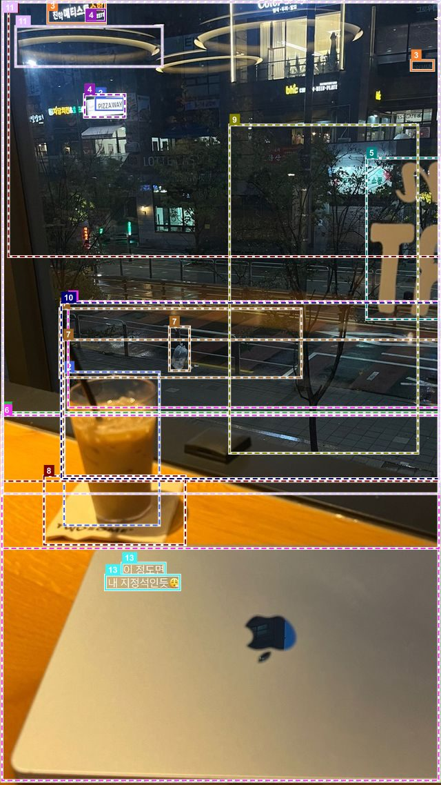
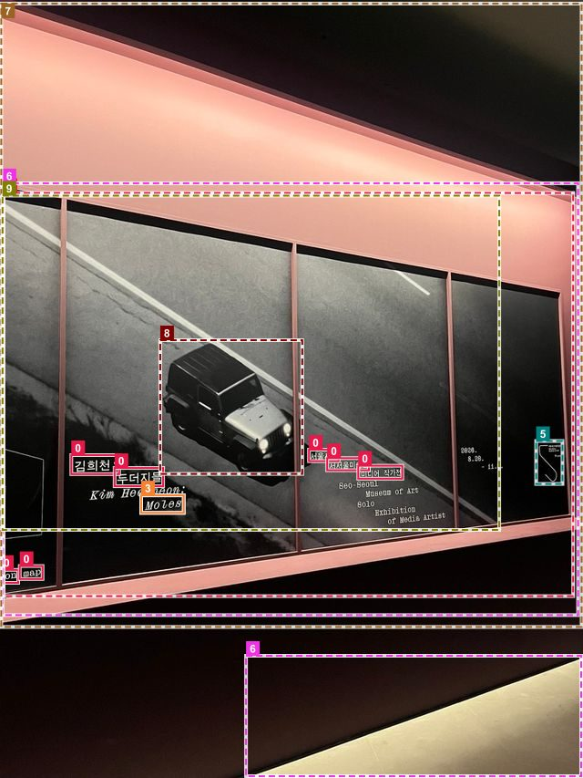
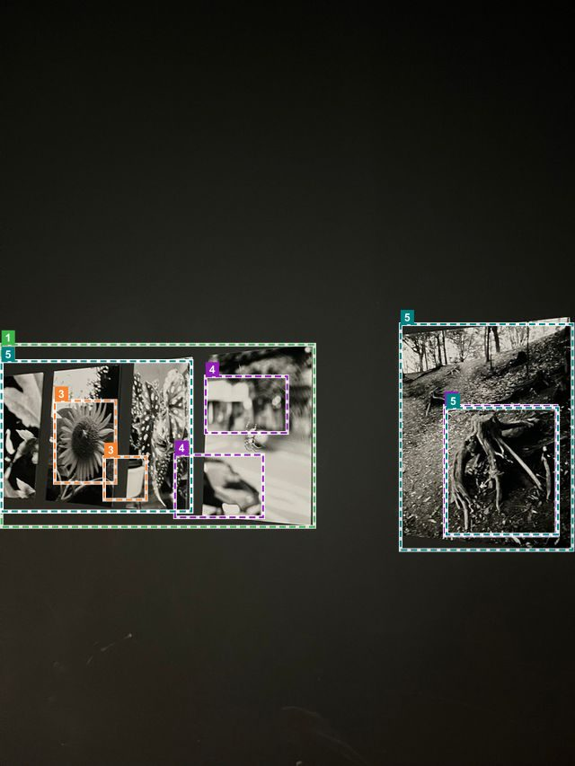

# 진행 보고서 (2026-11-14 기준)

`location-cue-lab`의 논문 정렬 작업이 지금 어디까지 됐는지 한 문서로 정리했습니다. 새 사진의 영역 연결은 요청에 따라 도중에 멈췄고, 그 상태도 여기에 적었습니다.

## 1. 한눈에 보기

| 항목 | 상태 |
|---|---|
| 논문 정렬 작업 1~8번 | 모두 완료 |
| 사진 | 152장 (새 사진 139장, 이전 사진 13장) |
| 단서 추출 | 152장 모두 완료. 단서 1,594개 |
| 범주 체계 | 84개 (논문의 31개 + ClueMiner가 추가한 53개). 수렴하지 않은 상태 |
| 분류 | 152장 모두 84개 체계로 완료 |
| 주소 추정과 채점 | 101장 완료 (새 사진 91장, 이전 사진 10장) |
| 영역 연결 (상자 표시) | 152장 모두 완료 (위험 등급으로 찾을 대상을 줄여 다시 실행. 7절) |
| 장소 검색 | 이전 10장만. 새 사진은 하지 않음 |

모델 호출은 전부 Claude 대역(호출마다 새 세션)이 했습니다. OpenAI 키가 없어 논문의 모델로는 돌리지 못했습니다.

## 2. 오늘 한 일

### 2.1 새 사진의 주소 추정과 채점 (작업 7-1)

- 새 사진 139장 중 91장에 "어디인가"를 물었습니다. 1차는 폴더별 10장씩 59장, 2차는 합정·가산·충무로의 남은 32장입니다.
- 좌표가 없는 사진은 폴더 이름이 가리키는 곳을 기준으로 판정했습니다. 기준점은 같은 폴더에서 좌표가 있는 사진들의 중심점이고, 가산디지털단지는 좌표가 하나도 없어 역의 위치를 썼습니다.
- 처음 기준(좌표 500m, 폴더 1,000m)으로는 91건 중 30건이 맞았습니다.

| 폴더 | 전체 | 주소 추정을 한 사진 | 맞힌 건수 (처음 기준) |
|---|---|---|---|
| 집_금천구 | 9 | 9 | 2 |
| 집_당산 | 19 | 10 | 5 |
| 집_합정 | 27 | 27 | 1 |
| 학교 | 49 | 10 | 8 |
| 회사_가산디지털단지 | 13 | 13 | 4 |
| 회사_충무로 | 22 | 22 | 10 |
| 합계 | 139 | 91 | 30 |

- 합정은 27장을 다 넣고도 1건입니다. 카페 실내 사진이 많아 상호만 읽고 주소를 내지 못하거나, 성수·이태원 같은 다른 번화가로 답했습니다.
- 충무로는 거리와 건물 사진이 많아 22장 중 10건을 맞혔습니다.

### 2.2 ClueMiner 입력 기준 결정

- 논문의 기준은 "대도시권을 맞힌 응답"입니다. 사진이 모두 서울이라 이 기준으로는 91건 중 79건이 통과해 걸러 내지 못했습니다.
- 그래서 더 좁은 기준을 정했습니다.

| 사진 | 넣는 조건 |
|---|---|
| 좌표가 있는 사진 | 500m 이내. 또는 1,000m 이내이면서 구가 맞음 |
| 좌표가 없는 사진 | 폴더 기준점에서 1,000m 이내이면서 구가 맞음 |

- 이 기준으로 새 사진 34건, 이전 8건과 합쳐 42건이 해당합니다. 학교(같은 기관)가 15건이라 5건으로 잘라 32건을 썼습니다.
- 폴더별 구는 폴더 이름으로 정했습니다: 금천구(집_금천구, 가산디지털단지), 영등포구(당산), 마포구(합정), 동작구(학교), 중구(충무로).

### 2.3 ClueMiner 실행 (작업 7)

- ClueMiner에 넣는 단서를 논문 방식으로 바꿨습니다. 이전에는 Detector가 뽑은 단서를 넣었고, 지금은 맞힌 주소 추정이 근거로 든 단서를 넣습니다.
- 32건(단서 232개)을 논문의 31개 유형에서 출발해 세 바퀴 넣었습니다.

| 바퀴 | 끝났을 때 범주 | 새로 추가 | 삭제·병합 |
|---|---|---|---|
| 시작 | 31 | | |
| 1 | 76 | 45 | 0 |
| 2 | 82 | 6 | 0 |
| 3 | 84 | 2 | 0 |

- 세 바퀴째에도 2개가 늘어 수렴 조건(한 바퀴 동안 변화 없음)을 채우지 못하고 멈췄습니다.
- 분석기는 추가만 했습니다. 합치거나 지운 범주가 없고, 논문의 31개 유형은 이름과 정의가 그대로입니다.

### 2.4 범주 검토와 묶음

- 84개는 그대로 두고, 새 범주 53개에 묶음을 붙였습니다. 논문의 다섯 묶음에 40개, 새 묶음 둘("상점과 소비" 8개, "사람·계절·사진" 5개)에 13개입니다.
- 묶음은 집계와 화면 표시에만 쓰이고 분류기에는 전달되지 않습니다.

### 2.5 단서 추출과 분류 (작업 8)

- 새 사진 139장 전부의 단서를 추출했습니다. 단서 1,443개가 나왔고 모두 첫 시도에 형식대로 답했습니다.
- 이전 13장을 포함한 152장의 단서 1,594개를 84개 체계로 분류했습니다.

| 묶음 | 단서 | 비율 | 나온 사진 |
|---|---|---|---|
| 식별 표지 | 484 | 30% | 151장 |
| 건물 특징 | 322 | 20% | 142장 |
| 도시 계획 | 200 | 13% | 91장 |
| 도시 기반 시설 | 182 | 11% | 88장 |
| 상점과 소비 | 150 | 9% | 52장 |
| 대지 특징 | 131 | 8% | 92장 |
| 사람·계절·사진 | 125 | 8% | 86장 |

- 84개 범주 중 80개가 쓰였습니다.
- 논문의 31개 유형에 730개(46%), 새 범주 53개에 864개(54%)가 분류됐습니다. 논문의 표만으로는 이 사진들의 단서 절반을 담지 못합니다.
- 가장 많은 범주는 상업 간판(111개), 문자·언어(109개), 기후 지표(103개)입니다. 뒤의 둘은 대부분 "한국으로 보인다" 수준이라 장소를 좁히는 힘은 약합니다.
- 위치를 직접 드러내는 종류는 수가 적습니다: 기관 표지 44개, 번지 표지 11개, 건물 이름 글자 10개, 전화번호 형식 10개, 다른 가게의 광고 9개, 지명 표지 5개.

사진 152장 각각의 단서와 분류는 `paper-classification-report.md`에 있습니다.

## 3. 영역 연결: 멈춘 상태

영역 연결은 단서가 사진의 어디에 있는지 찾는 단계입니다. 논문에는 없고, 꼭꼭의 결과물(가릴 영역)에 필요해서 넣은 단계입니다.

| 단계 | 대상 | 상태 |
|---|---|---|
| 검출 대상 뽑기 (대역) | 140장 | 140건 모두 답이 옴 |
| 글자·물체 검출 (이 컴퓨터) | 140장 | 3장 완료. 137장은 하지 않음 |

- **멈춘 이유**: 한 장에 약 4분 30초가 걸렸습니다(첫 장 272초). 물체 검출이 내장 그래픽이라 CPU로 돌아가기 때문입니다. 세 묶음을 동시에 돌려도 3시간 반에서 5시간이 예상됐고, 요청에 따라 중지했습니다.
- **중지 뒤 확인**: 실행 중이던 프로세스가 남아 있지 않은 것, 기록이 깨지지 않은 것(테스트 54개 통과, 152건 모두 읽힘)을 확인했습니다. 처리 중이던 사진은 저장 전에 멈춰서 영역이 없는 상태 그대로입니다.
- **이어서 하려면**: 대역의 답 140건이 저장돼 있어 같은 명령을 다시 실행하면 모델 호출 없이 검출만 이어집니다.

```powershell
node scripts/paper.mjs regions --all --handoff claude-fable-5-2
```

### 영역이 붙은 새 사진 3장

| 사진 | 단서 | 영역이 붙은 단서 | 글자 영역 | 물체 영역 | OCR이 읽은 줄 |
|---|---|---|---|---|---|
| 집_금천구 1 | 14 | 14 | 6 | 35 | 14 |
| 집_금천구 2 | 10 | 7 | 9 | 18 | 17 |
| 집_금천구 3 | 9 | 6 | 0 | 23 | 0 |







- 상자의 번호는 그 사진의 단서 번호입니다. `paper-classification-report.md`의 "집_금천구 1~3" 표와 대응합니다.
- 한 장을 눈으로 확인했습니다(집_금천구 1). 간판 글자와 컵, 노트북 등에 상자가 그려졌고, 화면 대부분을 덮는 큰 상자도 여럿 있습니다. 상자가 단서와 맞는지는 검토하지 않았습니다.
- 집_금천구 3은 OCR이 글자를 한 줄도 읽지 못했습니다.

## 4. 남은 일

| 일 | 규모 | 비고 |
|---|---|---|
| 새 사진의 장소 검색 | 사진에서 읽은 글자를 네이버 검색에 넣음 | 상호만 읽고 주소를 못 낸 사진(합정·가산의 카페)이 드러나는지 확인 |
| 나머지 48장의 주소 추정 | 대역 48회 | 학교 39장, 당산 9장. 분류에는 필요 없었음 |
| 분류와 번역의 검토 | 사람이 표본을 확인 | 지금은 형식만 확인된 상태 |

## 5. 알아두실 한계

- **모델이 논문과 다릅니다.** 주소 추정, 단서 추출, ClueMiner, 분류 모두 Claude 대역입니다.
- **범주 체계는 수렴하지 않았고 사람이 검토하지 않았습니다.** 입력 32건은 논문(596건)에 비해 매우 작습니다.
- **분류가 맞는지 확인하지 않았습니다.** 분류기의 답을 형식만 확인해 실었습니다.
- **한글 요약은 번역입니다.** 별도 세션들이 번역했고 누락과 형식만 기계적으로 확인했습니다.
- **맞힌 추정 30건 중 16건은 좌표가 아니라 폴더 이름으로 판정했습니다.** 폴더별 구도 폴더 이름으로 정한 것입니다.
- **사진이 작습니다.** 새 사진은 긴 변이 480~2,048픽셀로 줄어든 파일입니다.
- **테스트가 없는 코드가 있습니다.** 폴더 기준 채점, 구 판정, 입력 선정, 묶음 붙이기입니다. 나머지 테스트 54개는 통과합니다.

## 6. 문서와 데이터의 위치

| 내용 | 위치 |
|---|---|
| 작업별 변경 기록 (무엇을 왜 바꿨나, 논문과의 차이) | `paper-alignment-changes.md` |
| 사진 152장의 단서와 분류 | `paper-classification-report.md` |
| 이전 12장의 검사 결과 (31개 체계 기준, 상자 그린 사진 포함) | `paper-clue-inspection-report.md` |
| 사진별 기록 | `location-cue-lab/private-data/paper/runs/` |
| 범주 체계 (묶음 포함 84개) | `location-cue-lab/private-data/paper/taxonomy/20261114T034655-5ce3eefa9b10.json` |
| 사진 번호와 기록의 대응 | `location-cue-lab/private-data/paper/batches/all-photos.json` |
| 미리보기 페이지 | `location-cue-lab/private-data/paper/preview/index.html` |

## 7. 이후 진행: 위험 등급과 영역 연결 (같은 날 추가)

3절에서 멈췄던 영역 연결을, 찾을 대상을 줄여 152장 모두 끝냈습니다. 3절은 멈췄던 시점의 기록으로 남겨 둡니다.

- **뷰어**: 사진을 한 장씩 보며 단서별로 상자를 켜고 끄는 페이지를 만들었습니다. `location-cue-lab/private-data/paper/viewer/index.html`
- **위험 등급**: 84개 범주에 A(특정 장소) 14개, B(동네·지역) 32개, C(나라·계절·일반) 38개의 등급 초안을 매겼습니다. `risk-tier-draft.md`
- **검출 대상 축소**: 물체 검출은 A 등급 단서만, 글자 대조는 A와 B 등급 단서만 합니다. 사진당 물체 문구가 약 20개에서 2.4개로 줄었습니다.
- **시간**: 같은 세 장이 83초, 42초, 14초였습니다 (이전에 첫 장은 272초).

| 등급 | 단서 | 영역이 붙음 | 찾았으나 없음 | 찾지 않음 |
|---|---|---|---|---|
| A | 291 | 220 | 71 | 0 |
| B | 523 | 61 | 15 | 447 |
| C | 780 | 0 | 0 | 780 |

- 영역이 하나라도 붙은 사진은 128장입니다.
- A 등급 단서 중 글자를 인용한 141개 가운데 93개(66%)는 OCR이 그 글자를 실제로 읽었습니다. 나머지 34%는 없는 글자를 적었거나, OCR이 놓쳤거나, 옮겨 적어 대조가 안 된 경우이고, 나누어 세지는 않았습니다.
- 등급은 범주 정의를 읽고 매긴 초안이며 검증되지 않았습니다. 자세한 내용은 `paper-alignment-changes.md`의 작업 9에 있습니다.
